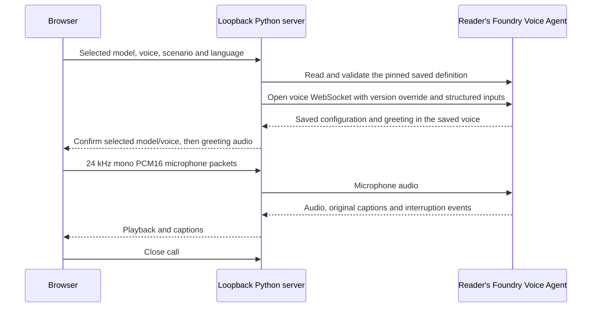

# Banking consultation Voice Agent

A phone-shaped browser sample for a **Foundry Voice Agent** using Voice Live
for speech input and output. Nora helps explore overdrafts and beginner
investing at **Northstar Demo Bank**.

**Entirely fictional:** the bank, assistant persona, account/product names,
profiles, balances, fees and policies are invented educational examples.
No real customer records, financial providers or banking systems are connected.
There are **no transaction, lookup, application or investment tools**. This is
not personal investment advice, a credit approval or a real product offer.
Use hypothetical information only.

The UI supports English, German and Chinese, original-language captions,
microphone mute, interruption, and a previous-conversation view. Ending or
cancelling a call returns to the home screen without deleting its captions.
The next call clears that history and starts a fresh cloud conversation.

## Model and voice choices

Model and Voice are independent selectors. Switching models resets the voice to
that model's default. Both selectors, the language and the scenario are locked
from the beginning of connection until the call ends. Model, voice and language
preferences are remembered locally; captions are not.

| Managed model | Default voice | Other sample voice | Voice type |
| --- | --- | --- | --- |
| `gpt-realtime-2.1` | **`en-US-Harper:MAI-Voice-2.1-Flash`** | `en-US-Ava:DragonHDLatestNeural` | `azure-standard` |
| `azure-realtime` | **`ava`** | `andrew` | `azure-realtime-native` |

These are a deliberately small allowlist, not the full service voice catalog.
Availability of **every listed model and voice** depends on your project's
region, service rollout and access. Check support before creating the Agents.
No alternative model or voice is silently substituted.

The selected language determines the greeting and initial conversation
language. The Agent then follows clear spoken language changes; the selected
voice is not changed. Captions preserve the original speech, not a translation.
The initial UI language is German; the initial model/voice is GPT + Harper.

## Architecture



`setup_agents.py` explicitly creates **four separate Agents, one per legal
model/voice pair**, in your existing project. The resulting version mapping
belongs to your resource and is stored only in an ignored `*.local.json` file.
No pre-existing Agent name, version or project is included. Each bindings file
has its own random Agent-name prefix, and each pair always uses the same Agent
name under that prefix.

A saved voice is selected **before opening the connection**. The server never
uses `session.update` to change the voice: native realtime voice updates are
not a reliable replacement for a saved voice, and a greeting can be generated
before an update takes effect. Pinning a dedicated saved version makes the
greeting and subsequent output use the same requested voice.

The server reads back the selected version on each call and rejects a different
prompt, tools, voice, storage or agent type. It also requires the initial
`session.updated` to confirm the exact model, voice, mono 24 kHz PCM, automatic
responses, interruption and automatic truncation before enabling microphone
upload or forwarding buffered greeting audio.

Credentials stay on the server. Structured input values contain only
application-selected language, greeting and synthetic scenario data.
The server uses the public `x-ms-voice-structured-inputs` compatibility header,
not a prompt replacement or browser-provided instructions.

## Prerequisites and installation

Requires Python **3.11+**, Node.js **22+** for JavaScript tests, and a current
Edge or Chrome browser with AudioWorklet. Browser audio needs a secure context:
the printed loopback URL works locally. The application is intentionally
loopback-only, not a hosted or multi-user gateway.

From the repository root, in PowerShell:

```powershell
Set-Location samples\example37_banking_consultation
python -m venv .venv
.\.venv\Scripts\python.exe -m pip install -r requirements.txt
```

On Linux/macOS:

```bash
cd samples/example37_banking_consultation
python3 -m venv .venv
.venv/bin/python -m pip install -r requirements.txt
```

This sample has its own dependencies. It does not require the repository
portal, PyAudio, a private platform checkout, npm packages, containers, or a
cloud-hosted application.

## Preview the UI without Azure

```powershell
.\.venv\Scripts\python.exe server.py --demo
```

On Linux/macOS, use `.venv/bin/python` for this and the following commands.
Open **http://127.0.0.1:8766**, select a language, model and voice, choose a topic,
and click **Start preview**. End the preview and open **Previous conversation**.

**Offline preview is scripted captions only.** It does not request your
microphone, recognize speech, invoke a model or generate/play audio. The
model/voice controls preview their selection behavior, not voice quality.
Use `--port <unused-port>` if the default port is already occupied.

## Create Agents in your own project

Use an **existing Foundry Project with Voice Agent access** and support for all
four allowlisted combinations. Your identity needs permission to create and
enable Voice Agents and to read/connect to their saved versions. See
[Foundry project RBAC](https://learn.microsoft.com/azure/ai-foundry/concepts/rbac-azure-ai-foundry).

Copy `.env.example` to `.env` only if `.env` does not already exist:

```powershell
if (-not (Test-Path .env)) { Copy-Item .env.example .env }
```

On Linux/macOS: `[ -f .env ] || cp .env.example .env`.
Set **your own** `AZURE_AI_PROJECT_ENDPOINT` in `.env`:

```dotenv
AZURE_AI_PROJECT_ENDPOINT=https://<account>.services.ai.azure.com/api/projects/<project>
AZURE_CREDENTIAL_MODE=cli
BANKING_AGENT_BINDINGS=bindings.local.json
```

Sign in with `az login`. `cli` uses Azure CLI credentials; `default` uses
`DefaultAzureCredential` for an environment configured by you.

First inspect the plan, which makes **no Azure requests**. It reads any existing
local bindings and shows, for each pair, whether setup would create an Agent,
publish a new version or leave it unchanged:

```powershell
.\.venv\Scripts\python.exe setup_agents.py
```

When you are ready to write to your existing project:

```powershell
.\.venv\Scripts\python.exe setup_agents.py --create
```

`--create` creates, reads back and enables four managed Voice Agents. It does
**not** create a resource, project, model deployment, container app or registry.
These Agents are retained for reuse. Cloud voice calls incur service charges.
The sample's local preview and tests do not run this creation command.

The script writes `bindings.local.json` before its first Azure request and
updates it after each pair succeeds. Rerun the same command after a failure or
interruption: completed pairs are skipped and the remaining pairs reuse their
planned Agent names, so a retry does not leave extra Agents behind. When this
sample's Agent definition changes, rerunning setup publishes a new version under
each existing Agent name. With complete, current bindings it makes no Azure
changes; the server still verifies each saved version before a call and refuses
incomplete or outdated bindings. Do not hand-edit bindings to point at
unrelated Agents.

Keep `.env` and every generated `*.local.json` private and out of source control.
They contain your resource context and Agent mappings, even without a token.
Imports, server startup and calls never create, enable or change an Agent.

## Talk to the Agent

Stop the offline server with Ctrl-C, then run:

```powershell
.\.venv\Scripts\python.exe server.py
```

Open the loopback URL, choose your model and voice, and start a conversation.
Allow the microphone when asked. Use a headset. Microphone upload starts only
after the service confirms the selected saved configuration.

Example **hypothetical** requests:

- "I'd like to discuss a 2,400 euro overdraft for an unexpected expense."
- "Could you compare the two fictional accounts?"
- "I'm new to investing. How do ETFs differ from the Starter Demo Portfolio?"
- "Ich möchte einen fiktiven Sparplan besprechen."
- "我想了解虚构投资案例的费用和风险。"

The overdraft scenario supplies **Synthetic profile A**, Everyday Demo Account
and a **EUR 1,500** existing limit. The investing scenario supplies **Synthetic
profile B** and **EUR 4,500** savings. Neither profile represents a real person.
Other details are unknown until the caller explores them hypothetically.

The saved definition includes server-side echo cancellation, noise reduction,
Azure Speech transcription and multilingual semantic VAD
(`azure_semantic_vad_multilingual`) for English, German and Chinese turns.
The browser also requests echo
cancellation and noise suppression. It resamples its native capture rate to
24 kHz mono PCM16 and plays service PCM at 24 kHz.

Speak over a reply to interrupt it. The service cancels/truncates the response,
and the browser stops queued and scheduled playback. Audio upload and playback
queues are bounded; unsupported configuration or lag ends the call explicitly.
If one utterance cannot be transcribed or one reply does not finish, the
captions say so and the call continues; ask again. Session-level service errors
end the call. Switching tabs keeps the call open; closing or leaving the page
ends it and releases the microphone.

## Fictional facts and privacy

| Example product | Invented terms |
| --- | --- |
| Everyday Demo Account | EUR 4/month; illustrative variable overdraft rate 13% per year. |
| Travel Demo Account | EUR 7/month; illustrative variable rate 11%; a fictional travel-card benefit. No actual card or insurance. |
| Starter Demo Portfolio | Illustrative annual total fee 1.20%; Cautious Demo, Balanced Demo and Growth Demo options. Contributions from EUR 10, investing at EUR 100 accumulated. Not a real managed product. |

These are not current market data, real offers or recommendations. Investments
can lose value. There is no connected bank, insurer or asset manager.
Do not submit real financial or identity information.

`store=False` in every saved Agent and `store=false` on the connection disable
configured conversation persistence; they do not promise zero Azure telemetry
or retention under the service's terms. The local server does not persist
recordings, captions, prompts or transcripts and does not provide downloads.
It does not print raw service error messages or resource URLs.

The browser keeps at most **200 caption entries in page memory**, including the
most recent ended conversation. Starting another call or reloading clears them.
Only model, voice and language preferences enter local storage. Clearing local
preferences does not delete your saved Azure Agents. Delete unused Agents in
Foundry yourself.

The UI and compass icon are self-authored; no customer logos, screenshots,
recordings, remote fonts or third-party UI libraries are shipped. Python
dependencies retain their respective licenses.

## Validation and limitations

From this sample directory:

```powershell
.\.venv\Scripts\python.exe -m unittest discover -s . -p "test_*.py" -q
node --test test_ui.mjs test_audio.mjs
.\.venv\Scripts\python.exe setup_agents.py
```

Tests cover model/voice legality and preference resets, lock behavior,
original-language caption accumulation, PCM resampling and playback bounds,
same-origin routing, private mappings, resumable setup and new versions,
definition readback, pinned connection versions, greeting buffering and
recoverable turn failures. Mock cloud tests assert that no Agent writes
or voice overrides occur during a call. The preview and mocks are **not** live
Azure or physical audio validation.

Validate all four pairs and all three initial languages in your own supported
project before relying on the audio experience. Confirm greeting voice,
microphone/STT, multilingual switching, interruption, captions, end-to-home and
history on your intended devices. An authenticated live call and an actual
microphone/speaker check remain separate from the offline checks.

This is a local teaching sample with one active call, not a production banking
application or an authenticated customer channel. No remote access/deployment
workflow is included.
