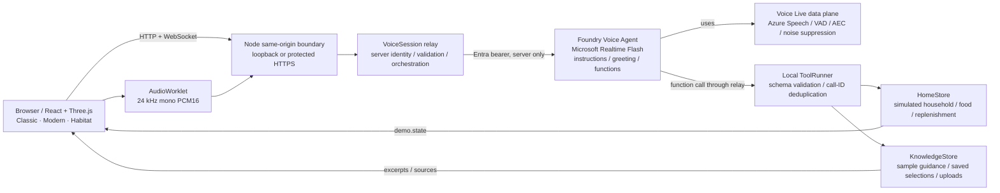
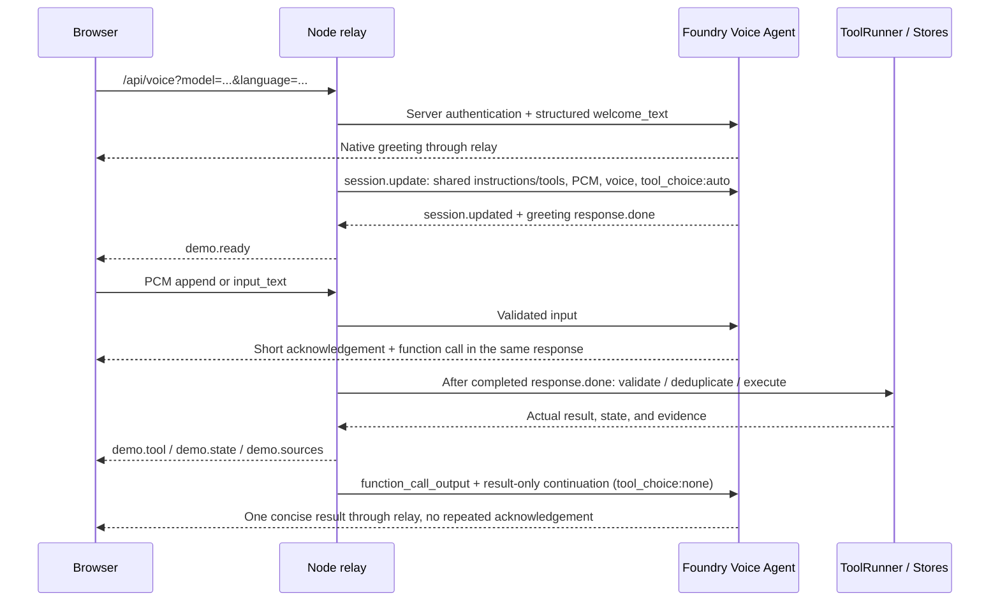
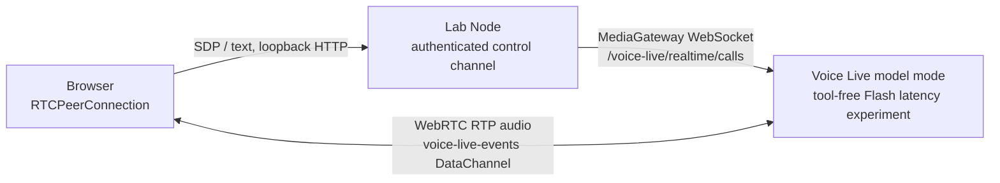
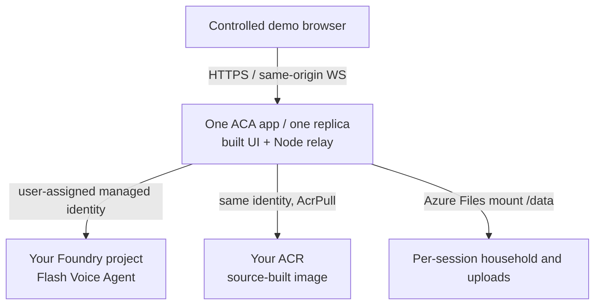

# Architecture and security boundaries

## Voice Agent and Voice Live

**Voice Agent → uses → Voice Live.** Foundry Agents service creates, configures,
and versions the Voice Agent, including model selection, instructions, greeting,
speech settings, and functions. Voice Live is the realtime speech data plane
for transcription, VAD, audio processing, and output. Node is a relay with local
tool execution authority, not a second Hosted Agent.



All three UIs share the API, household protocol, audio implementation, and tools.
Modern provides controls and procedural scene utilities reused by Habitat.
Cameras, materials, and rendering do not grant extra browser permissions.
All 3D content is generated by authored source code: no external product images,
CAD, scene assets, or CDN fonts are needed.

## Browser / Node boundary

The browser may send bounded user text, PCM, cancellation/commit, and valid
audio truncation events. It may not select an arbitrary upstream endpoint,
replace system instructions or schemas, supply function output, or declare
device success. HTTP and WebSocket requests validate Host and same origin.
Request bodies, audio frames, queue backpressure, and session lifetimes are
bounded; failures are surfaced rather than replaced by fabricated replies.

Local credentials use `AzureCliCredential`; cloud credentials use
`ManagedIdentityCredential`. `attachVoice()` creates `VoiceDependencies` once
per application instance, so sessions reuse the credential/token cache instead
of constructing a new managed-identity credential on each connection.
Tokens stay on the server and out of source and logs. Session metadata is not
blindly passed through; raw service errors become sanitized messages.

Local mode is loopback-only. Each edition's Vite proxy validates the original
request Origin before rewriting Host/Origin to a fixed loopback backend.
This is a development boundary, not public authentication. Cloud mode serves
built static assets and the same-origin API from Node, without Vite.

## WebSocket flow



`demo.ready` requires configuration confirmation and greeting completion so the
first request cannot overlap the welcome. UI language selects the initial
greeting and interface; recognition stays `zh-CN,en-US`, and replies follow the
latest user turn. Switching models ends the old session; it does not transfer
its conversation context.

## Speech profile and pre/post-tool orchestration

Verify this Flash profile in the actual target project:

| Setting           | Value                                                                                                           |
| ----------------- | --------------------------------------------------------------------------------------------------------------- |
| Input/output      | `audio/pcm`, `rate: 24000`; browser mono PCM16.                                                                 |
| AEC               | `server_echo_cancellation`, `reference_source: server`, `channels: 1`.                                          |
| Noise suppression | `azure_personal_noise_suppression`, `detection_input: mas_dns`.                                                 |
| Transcription     | `azure-speech-streaming`, `language: zh-CN,en-US`.                                                              |
| Dynamic VAD       | `azure_semantic_vad`, `profile: normal`.                                                                        |
| Turn behaviour    | Flash `auto_truncate: false`; `create_response` and `interrupt_response`: `true`; `remove_filler_words: false`. |
| Output voice      | `zh-CN-Xiaoxiao:DragonHDFlashLatestNeural`.                                                                     |

Flash handles truncation itself; disabling automatic server truncation avoids
duplicate truncation races. Dynamic VAD runs in the managed speech data plane,
not a frontend keyword detector. The sample adds no separate speech-start
classifier or endpointing model. Session updates do not reset saved VAD,
transcription, or noise settings: publish a correct Agent definition first.

Global instructions and `control_device` require one model-authored short
acknowledgement before a control function in the same response. English requests
use "Sure." / "Got it."; Chinese requests use “好的。” / “好。” / “收到。”.
It contains no device, action, setting, plan, or claimed result. Queries do not
need it. Session `tool_choice: "auto"` allows this speech plus a function call,
without forcing calls for queries; `"required"` can make Flash omit the speech.

`VoiceSession` forwards the acknowledgement's audio and transcript without
injecting another response. It collects pending calls and executes them only
after a completed `response.done`; cancelled/failed responses discard them.
Tool results return with the original call ID, followed by a `tool_choice: "none"`
continuation that reports one actual result and does not repeat the acknowledgement.
A control emitted without speech still executes when otherwise valid: the relay
is not a hard-coded intent parser or a guarantee that the model always obeys
every speech instruction.

Unit tests cover the automatic tool policy, forwarding without injected turns,
silent calls, call-ID deduplication, cancellation, greeting gates, and continuation
order. Actual acoustic experience still needs live evaluation.

## Tools and knowledge

`ToolRunner` owns device controls, scenes, food/list edits, and retrieval.
Zod and shared control ranges validate input; a per-session call-ID cache avoids
duplicate execution. `HomeStore` revisions and subscriptions push authoritative
state to the UI. Setpoints do not change illustrative sensor readings; food
records do not come from a camera.

`KnowledgeStore` is bounded text retrieval, not a production vector database or
RAG pipeline. Checked-in guidance in `knowledge/products.json` concerns fictional
models `SAMPLE-TV-01`, `SAMPLE-FRIDGE-01`, and `SAMPLE-AC-01`, not manufacturers.
All product entries are `kind: "demo"` and the fixture contains no URLs;
`shared/appliances.ts` points to the checked-in public fixture as its source.
Retrieval ranking boosts exact model matches, so neutral sample identifiers
remain useful search keys rather than requiring brand keywords.
Entertainment fixtures contain five fictional entries dated 2026-11-12,
with source URLs pointing to the checked-in public fixture, not real platforms.
Uploads are evidence, never instructions. Answers should retrieve and cite
relevant excerpts, admit missing facts, and not invent warranties or certifications.
No real IoT, device account, media distribution, checkout, payment, or delivery
integration exists.

## Persistence and isolation

Local mode shares `.azure/home.json` and `knowledge/uploads/` across tabs and
editions. Do not expose it on a shared network. Cloud mode creates a household
directory per random signed browser session, never from an arbitrary client path:

```text
<SMART_HOME_DATA_PATH>/
  <random-session-id>/
    home.json
    uploads/
```

The HMAC cookie expires after 12 hours and uses HttpOnly, Secure, SameSite=Lax,
and the `__Host-` prefix. Each instance allows at most 100 households. Cookie
expiry does not delete disk data; operators must define retention and cleanup.
A new browser or signing-secret rotation loses access to the old session.
An access code is not a cross-device identity.

File persistence is single-replica, not distributed transactional storage.
Fresh Agent templates use `store: false`; existing settings and service
data-processing requirements must still be reviewed.

## Separate model-mode WebRTC lab



This lab has no Foundry Agent, household tools, knowledge/store, or application
pre/post-tool flow. Per-turn timing uses the first `output_audio_buffer.started`,
not physical DAC/speaker onset. Browser ICE/STUN and network conditions affect
it. The local server has session-count and lifetime limits but no production
user authentication; it is not a public WebRTC service.

Agent-mode WebRTC instead selects a saved Agent and needs authenticated signaling
plus server-side tool handling. It is **not wired into Classic, Modern, or Habitat**;
see [integration references](INTEGRATION.md).

## Optional deployment topology



The full application defaults to `SMART_HOME_MIN_REPLICAS=1` to avoid
scale-to-zero cold starts; explicit `0` saves idle cost but adds cold starts.
Maximum replicas remain one. This does not eliminate model, credential, or
network initialization overhead. The manifest renderer is offline and does not
query/deploy Azure or create RBAC. Public operation needs identity, abuse
protection, budgets, monitoring, and data governance beyond guest cookies.
See [deployment](deploy/README.md) for the separate lab's defaults and apply guard.
