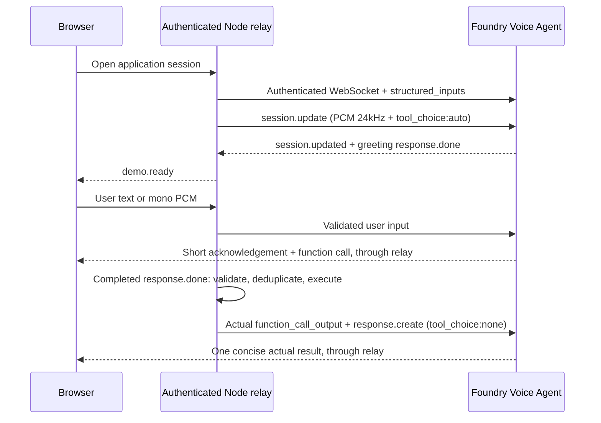

# Integration guide: Voice Agent, transports, and optional real devices

## Conclusion

The runnable sample uses a saved Foundry **Voice Agent** through an authenticated
Node **WebSocket** relay. The Agent uses **Voice Live** for speech input/output.
Local functions execute against a simulated household. No device adapter or
MCP server is connected.

This guide covers:

1. Reviewing and explicitly publishing a Flash Voice Agent in your own project.
2. The implemented WebSocket flow and an **unwired, project-dependent Agent-mode
   WebRTC reference**.
3. The additional authorization, adapters, receipts, and testing needed for real
   device APIs or MCP.

The separate model-mode WebRTC lab is not an implementation of step 2's
Agent-mode flow. Optional Azure commands below change state only when you
deliberately execute them and require authorization in your target environment.

## 1. Configure a Voice Agent

### Prerequisites and identity

Use Node.js **24.5+**, npm, Azure CLI, and your own Foundry resource/project.
The default is **Microsoft Realtime Flash**, `microsoft-realtime-flash-1`.
The only supported API model IDs are `microsoft-realtime-flash-1` and
`gpt-realtime-2.1`; keep the selected template and
`SMART_HOME_VERIFIED_MODELS` aligned. Product names and unversioned IDs are not
aliases. Do not assume model access, regions, or quota are interchangeable.

`model_type: managed` selects a service-managed model, not a deployment name.
It needs no separately created Azure OpenAI deployment with the same name.
`self_deployed` requires a deliberate model deployment and matching definition
adaptation; this sample does not make that conversion automatically.

Agent management requires project read/create/update/enable capabilities
(such as Foundry Agent Developer); runtime requires consumption capabilities
(such as Foundry Agent Consumer). Use your project's actual role definitions.
Runtime uses server-side managed identity in cloud mode and `AzureCliCredential`
locally. Do not grant subscription Owner for convenience or send API keys/Entra
tokens to the browser.

For optional live setup, replace every placeholder and run from the repository root:

```bash
export AZURE_TENANT_ID="<your-tenant-id>"
export AZURE_SUBSCRIPTION_ID="<your-subscription-id>"
export FOUNDRY_PROJECT_ENDPOINT="https://<resource>.services.ai.azure.com/api/projects/<project>"
export SMART_HOME_FLASH_AGENT="<your-flash-agent-name>"

az login --tenant "$AZURE_TENANT_ID"
az account set --subscription "$AZURE_SUBSCRIPTION_ID"

cd samples/example37_smart_home_appliance_agent
npm ci
```

`az account set` selects the CLI subscription; authoring and conversations
target the project in `FOUNDRY_PROJECT_ENDPOINT`. Do not commit populated scripts
or environment files. Offline manual controls need none of this Azure setup.

### Definition and speech profile

This YAML illustrates the Portal-style Voice Agent definition. It is **not**
the final upload payload: instructions/tools must be populated by rendering.
REST authoring receives JSON, not this YAML:

```yaml
kind: voice
model: microsoft-realtime-flash-1
model_type: managed
sub_protocol: realtime
instructions: "" # Filled from server/instructions.ts and instructions.txt.
tools: [] # Filled from server/tools.ts.
store: false
output_modalities: [audio, text]
structured_inputs:
  welcome_text:
    description: Initial welcome only; speech recognition remains bilingual.
    schema:
      type: string
      minLength: 1
      maxLength: 200
    default_value: Hello, I'm your home assistant. What would you like help with today?
greeting:
  type: template
  text: "{{{welcome_text}}}"
audio:
  input:
    format:
      type: audio/pcm
      rate: 24000
    echo_cancellation:
      type: server_echo_cancellation
      reference_source: server
      channels: 1
    noise_reduction:
      type: azure_personal_noise_suppression
      detection_input: mas_dns
    transcription:
      model: azure-speech-streaming
      language: zh-CN,en-US
    turn_detection:
      type: azure_semantic_vad
      profile: normal
      auto_truncate: false
      create_response: true
      interrupt_response: true
      remove_filler_words: false
  output:
    format:
      type: audio/pcm
      rate: 24000
    voice: zh-CN-Xiaoxiao:DragonHDFlashLatestNeural
    voice_type: azure-standard
```

The authoritative sources are `agents/flash.json`, `server/voice-profile.ts`,
`server/greeting.ts`, `server/instructions.*`, and `server/tools.ts`.
The YAML's English welcome is illustrative; rendering uses the source default
and connection language chooses the English/Chinese structured welcome.
Recognition remains bilingual. Flash **`auto_truncate: false`** avoids duplicate
truncation races because the model handles truncation itself.

Check every speech capability against the target service. The publisher preserves
configured Flash noise/transcription fields on existing Agents, supplies them
when absent, and adds missing bilingual language candidates for Azure Speech
streaming transcription. Preserved settings must still be reviewed and tested.
Do not delete AEC/noise settings or silently change models to claim success.

### Render offline, then publish explicitly

```bash
# No Azure queries or modifications.
npm run agents:render

# Optional: wrap only the rendered Flash definition as a REST request.
node --input-type=module <<'NODE'
import { readFileSync, writeFileSync } from "node:fs";
const definitions = JSON.parse(
  readFileSync(".local/agent-definitions.json", "utf8"),
);
writeFileSync(
  ".local/flash.request.json",
  `${JSON.stringify({ definition: definitions.flash }, null, 2)}\n`,
  { mode: 0o600 },
);
NODE
```

Review the complete instructions, **eight** function schemas, greeting, dynamic
VAD, and audio settings. Fresh templates use `store: false`; updating an existing
Agent preserves its current store/output settings.

Prefer the checked publisher:

```bash
npm run agents:publish -- --confirm-project "$FOUNDRY_PROJECT_ENDPOINT"
```

The endpoint must be exported for shell expansion, or passed literally with the
same actual value as `.env`. The publisher rejects placeholders and mismatched
confirmation, requires an explicit `SMART_HOME_FLASH_AGENT`, and publishes
only Flash by default. It refuses a change to an existing Agent's kind, model,
or model type, preserves other Portal-owned fields, checks the latest version
again before writing, requires a new active version, and recursively reads
back all submitted fields. The concurrency check is not atomic: coordinate an
exclusive editing window. No resources, model deployments, or RBAC are created.

See [Agent definitions](agents/README.md) for explicit `--comparison` publishing,
which selects only the GPT Realtime Agent instead of Flash and is not a prerequisite.

### Optional raw REST alternative

Use this **instead of**, not after, the checked publisher. A direct POST writes
the submitted definition without the publisher's merge/concurrency guards.
For existing Agents, prefer the checked publisher to preserve other fields.

```bash
export AUTHORING_API_VERSION="2025-11-15-preview"

az rest --method post \
  --url "$FOUNDRY_PROJECT_ENDPOINT/agents/$SMART_HOME_FLASH_AGENT/versions?api-version=$AUTHORING_API_VERSION" \
  --resource "https://ai.azure.com" \
  --headers "Content-Type=application/json" "Foundry-Features=VoiceAgents=V1Preview" \
  --body @.local/flash.request.json \
  --query "{version:version,status:status}" --output json

# Read back the actual saved latest version for comparison.
az rest --method get \
  --url "$FOUNDRY_PROJECT_ENDPOINT/agents/$SMART_HOME_FLASH_AGENT?api-version=$AUTHORING_API_VERSION" \
  --resource "https://ai.azure.com" \
  --headers "Foundry-Features=VoiceAgents=V1Preview" \
  --query "versions.latest" --output yaml > .local/flash.saved.yaml
```

Compare version, `status: active`, exact model, instructions/tools, and all
audio/advanced fields; merely receiving a version number is insufficient.
If the target Agent is disabled, an authorized operator may explicitly enable it
using the target service's supported contract:

```bash
az rest --method post \
  --url "$FOUNDRY_PROJECT_ENDPOINT/agents/$SMART_HOME_FLASH_AGENT:enable?api-version=v1" \
  --resource "https://ai.azure.com" \
  --headers "Foundry-Features=VoiceAgents=V1Preview"
```

Configure the root server's `.env`, after inspecting the saved Agent/model:

```dotenv
FOUNDRY_PROJECT_ENDPOINT=https://<resource>.services.ai.azure.com/api/projects/<project>
SMART_HOME_FLASH_AGENT=<your-flash-agent-name>
SMART_HOME_VERIFIED_MODELS=microsoft-realtime-flash-1
```

`SMART_HOME_VERIFIED_MODELS` is an operator declaration, not a live-test result.
Live tests need it enabled; assess the connection in an isolated environment
before demonstrating it. Local template edits affect no saved Agent until
published, and new definitions do not rewrite already established sessions.

## 2. Talk to the saved Voice Agent

### Authentication and endpoint selection

Agent-mode transports select the saved Agent **name**, not a model name,
assistant ID, or resource ID. The backend acquires a token for
`https://ai.azure.com/.default` (CLI resource `https://ai.azure.com`).
SDK credentials reuse token caching. Do not echo tokens, put them in URLs,
browser subprotocols, DataChannel payloads, localStorage, or logs.

A service token is not end-user or household authorization. The application must
authenticate its users and enforce device ownership separately.

### Implemented WebSocket flow

The upstream endpoint is:

```text
wss://<resource>.services.ai.azure.com/api/projects/<project>/agents/<agent-name>/endpoint/protocols/voice?api-version=v1
```

The server handshake supplies `Authorization: Bearer <server-acquired-token>`.
An `agent_session_id` may identify the session, and URL-encoded
`structured_inputs` supplies `welcome_text`, for example
`{"welcome_text":"Hello, I'm your home assistant. What would you like help with today?"}`.
These parameters are not a browser channel for overriding instructions/tools.
For a fixed version, use supported `x-agent-version-override` behaviour with a
verified version belonging to that Agent.



On connection, send a session update with source-owned instructions/functions,
PCM formats, output voice, and **`tool_choice: "auto"`**. Wait for both
`session.updated` and the greeting's `response.done` before accepting the first
user turn. `"required"` can suppress Flash's short speech and forces unwanted
tools for queries/conversation. This shape is illustrative: replace empty tools
and the instruction placeholder with the actual server-owned definitions:

```json
{
  "type": "session.update",
  "session": {
    "type": "realtime",
    "instructions": "<server-owned-instructions>",
    "tools": [],
    "tool_choice": "auto",
    "output_modalities": ["audio", "text"],
    "audio": {
      "input": { "format": { "type": "audio/pcm", "rate": 24000 } },
      "output": {
        "format": { "type": "audio/pcm", "rate": 24000 },
        "voice": {
          "type": "azure-standard",
          "name": "zh-CN-Xiaoxiao:DragonHDFlashLatestNeural"
        }
      }
    }
  }
}
```

Do not reset the saved `turn_detection`, `noise_reduction`, or `transcription`
in connection updates. Text input uses these two frames:

```json
{
  "type": "conversation.item.create",
  "item": {
    "type": "message",
    "role": "user",
    "content": [{ "type": "input_text", "text": "Turn on the television." }]
  }
}
```

```json
{ "type": "response.create" }
```

Audio is base64 raw PCM16 little-endian, 24 kHz mono, **not** WAV, MP3, or
WebM. This is only a wire-format example containing two silence samples:

```json
{ "type": "input_audio_buffer.append", "audio": "AAAAAA==" }
```

Stream appropriately sized chunks. Automatic VAD manages turns; do not
commit/create for every chunk. Manual mode must follow its buffer protocol.
Correctly resample browser audio, often 48 kHz; relabelling metadata is not
resampling. See `src/lib/capture-worklet.ts`, `src/lib/audio.ts`, and
`src/lib/pcm.ts`.

| Event                                                                | Responsibility                                                                               |
| -------------------------------------------------------------------- | -------------------------------------------------------------------------------------------- |
| `session.created` / `session.updated`                                | Check configuration; this alone does not mean the greeting ended.                            |
| `response.audio.delta` / `response.output_audio.delta`               | Decode and queue PCM at the agreed sample rate.                                              |
| `response.audio_transcript.*` / `response.output_audio_transcript.*` | Handle incremental/final assistant transcripts.                                              |
| `conversation.item.input_audio_transcription.completed`              | Display user transcription.                                                                  |
| `response.function_call_arguments.done`                              | Collect allowlisted calls on the trusted backend; do not execute arbitrary browser commands. |
| `response.done`                                                      | Check completed/failed/cancelled, then schedule eligible tools and continuation.             |
| `input_audio_buffer.speech_started`                                  | Handle barge-in and stop queued old output.                                                  |
| `error`                                                              | Report failure and clean up; no fabricated response fallback.                                |

The original call ID links the **actual** tool result to the model:

```json
{
  "type": "conversation.item.create",
  "item": {
    "type": "function_call_output",
    "call_id": "<the-original-call-id>",
    "output": "{\"ok\":true,\"status\":\"succeeded\"}"
  }
}
```

```json
{
  "type": "response.create",
  "response": { "tool_choice": "none" }
}
```

Do not copy the illustrative `ok: true` as fabricated success. The relay waits
for a completed response, executes validated/deduplicated calls, sends real
results, and schedules a non-overlapping result-only continuation.
Cancelled/failed responses drop pending calls.

Global instructions and `control_device` require one short model-authored
acknowledgement **in the same response before the control function**:
"Sure." / "Got it." for English; “好的。” / “好。” / “收到。” for Chinese.
It names no device, setting, action, plan, or result. Queries do not need it.
The relay forwards speech/transcripts, injects no extra acknowledgement round,
and asks the result continuation not to repeat it. See `server/voice.ts` and
`tests/server-voice.test.ts`.

To run the complete application, from the configured sample root:

```bash
npm run dev
```

Open <http://127.0.0.1:5178>. The browser connects to the application's
`/api/voice?model=...&language=...`; Node maps an allowlisted model ID to the
saved Agent and opens the Azure endpoint. These URLs are not interchangeable.
Preserve same-origin checks, authentication, and household isolation when reusing
the relay.

### Agent-mode WebRTC reference — not wired into these UIs

Where the target Agent/model supports it, the candidate signaling endpoint is:

```text
wss://<resource>.services.ai.azure.com/api/projects/<project>/agents/<agent-name>/endpoint/protocols/voice?api-version=v1&transport=webrtc&agent_session_id=<unique-id>
```

Verify transport availability for the exact Flash Agent/project. Success with
another model or a direct model-mode lab does not establish Agent-mode support.
The backend retains the authenticated WebSocket control channel; the browser
exchanges SDP through your authenticated signaling API, then sends/receives
audio as WebRTC RTP with realtime events over `voice-live-events`.

```mermaid
sequenceDiagram
  participant B as Browser RTCPeerConnection
  participant R as Authenticated signaling backend
  participant A as Saved Foundry Voice Agent
  B->>B: Microphone tracks + DataChannel + SDP offer
  R->>A: Authenticated WS, transport=webrtc
  B->>R: Complete SDP offer
  R->>A: rtc.call.sdp.create
  A-->>R: rtc.call.sdp.created + sdp_answer
  R-->>B: SDP answer
  B->>B: setRemoteDescription; wait for ICE and readiness
  B->>A: WebRTC RTP microphone audio
  A-->>B: RTP output audio / DataChannel events
  Note over R,A: Keep control channel; retain server-side tool authorization
```

Create `RTCPeerConnection`, add microphone tracks initially disabled, and create
the `voice-live-events` DataChannel **before** the SDP offer so it includes the
SCTP/application media section. Configure STUN/TURN for your network and wait
for bounded ICE gathering or the service-supported candidate flow.
Send the complete offer through the authenticated backend:

```json
{
  "type": "rtc.call.sdp.create",
  "sdp_offer": "<the-full-browser-local-description-sdp>"
}
```

The corresponding event is:

```json
{
  "type": "rtc.call.sdp.created",
  "sdp_answer": "<the-service-sdp-answer>"
}
```

This browser fragment shows the integration points; it is **not** a complete
standalone client:

```javascript
async function negotiateAgentWebRtc({
  iceServers,
  exchangeOffer,
  remoteAudio,
  onAgentEvent,
}) {
  const peer = new RTCPeerConnection({ iceServers });
  const microphone = await navigator.mediaDevices.getUserMedia({
    audio: { channelCount: 1, echoCancellation: true, noiseSuppression: true },
  });
  microphone.getAudioTracks().forEach((track) => {
    track.enabled = false; // Enable only after media, configuration, and greeting.
    peer.addTrack(track, microphone);
  });
  const events = peer.createDataChannel("voice-live-events");
  events.onmessage = ({ data }) => onAgentEvent(JSON.parse(data));
  peer.ontrack = ({ streams }) => {
    remoteAudio.srcObject = streams[0];
  };
  await peer.setLocalDescription(await peer.createOffer());
  // exchangeOffer waits for bounded ICE gathering, then sends localDescription
  // through authenticated signaling and returns the service's sdp_answer.
  const answer = await exchangeOffer(peer);
  await peer.setRemoteDescription({ type: "answer", sdp: answer });
  return { peer, microphone, events };
}
```

The client sets the remote answer and enables microphone tracks only after
media, configuration, and greeting readiness. Implement user-gesture autoplay,
timeouts, failure cleanup, session termination, track stopping, and control-channel
closure. RTP codecs/rates are negotiated in SDP; RTP is not base64 PCM or JSON.

Function authority remains server-side. Handle calls and return outputs on
supported event/control paths, preserving authorization, call IDs, deduplication,
and result continuation. If an event appears on both control and DataChannel,
choose an authoritative source and do not execute twice. The short acknowledgement
and result use standard realtime events, not custom client event-dropping rules.

| Reference                                                                                                  | What it provides                                                                          |
| ---------------------------------------------------------------------------------------------------------- | ----------------------------------------------------------------------------------------- |
| This sample's `server/voice.ts` and three UIs                                                              | Complete WebSocket household flow; **no Agent-mode WebRTC wiring**.                       |
| [`../foundry_voice_webrtc/server.py`](../foundry_voice_webrtc/server.py), `Config.voice_url()` / `relay()` | Saved-Agent endpoint and signaling reference.                                             |
| [`../foundry_voice_webrtc/public/app.js`](../foundry_voice_webrtc/public/app.js), `connectWebRtc()`        | SDP, ICE, microphone, DataChannel, and remote audio reference.                            |
| This sample's `server/webrtc-benchmark.ts`                                                                 | Tool-free, direct **Voice Live model-mode** lab; not the above Agent-mode implementation. |

The reference sample has its own Agent setup/business logic, not this household
executor. Do not run its create/reset/apply-settings flows against the saved
smart-home Agent. Adding `transport=webrtc` to the current application route
does not wire signaling, tools, or continuation. Agent-mode, direct model-mode,
and Azure OpenAI `/openai/v1/realtime/calls` are different APIs. GPT Live's
`/voice/live/sessions` flow is also outside this Flash integration.

## 3. Optional real devices: direct API or MCP

### No real device connection is included

The existing chain is:

```text
Voice Agent function → Node VoiceSession → ToolRunner → HomeStore (simulated)
```

HomeStore success proves only that simulated state was saved. First obtain your
device platform's APIs, inventory, capabilities, authorization, and verifiable
state/action receipts. MCP is an architectural choice, **not a prerequisite**:

| Option                     | Chain                                                                      | Use                                                                            |
| -------------------------- | -------------------------------------------------------------------------- | ------------------------------------------------------------------------------ |
| Direct function            | Agent → relay/ToolRunner → device adapter → REST/MQTT/SDK/gateway          | Start with one authorized device while retaining the existing schemas/UI flow. |
| MCP inside relay           | Agent function → relay → trusted MCP client → device MCP server → platform | Keep relay orchestration while making capabilities reusable.                   |
| Foundry-managed remote MCP | Agent → protected project MCP connection/server → platform                 | Shared tooling; verify Agent/model support and approval/event handling.        |

No option automatically supplies drivers, tenant authorization, user confirmation,
or proof of execution. **No DeviceAdapter or real-device MCP server is implemented.**

### Direct-device execution requirements

Keep allowlisted schemas such as `get_home_state` and `control_device`.
Resolve logical device IDs to devices the authenticated user is allowed to
read/control; never accept arbitrary URLs, platform tokens, tenant IDs, or gateway
commands from the model. Reads also require ownership checks.

Current `ToolRunner.run()`, store operations, and associated calls are synchronous.
Remote execution requires asynchronous handling plus coordinated changes to
pending calls, cancellation, timeouts, and continuation. A fire-and-forget HTTP
request inside `home.control()` followed by existing `ok: true` is not sufficient.

A real adapter must:

- Read capabilities, online state, current state, and timestamps; distinguish
  target settings from measurements and stale data from current data.
- Validate actual model capabilities/ranges, not assume sample limits are
  manufacturer specifications.
- Use application-generated request IDs/idempotency keys and correlated receipts.
- Distinguish `accepted`, `succeeded`, `failed`, and `unknown`. HTTP `200/202`
  alone does not prove physical execution.
- Query action status after a timeout rather than blindly repeating actions.
- Push confirmed state/failure to the UI and Agent; never silently fall back
  from real devices to simulated success.

An **illustrative adapter contract**, not an existing tool result, could be:

```json
{
  "ok": true,
  "status": "succeeded",
  "requestId": "<application-generated-request-id>",
  "deviceId": "<authorized-device-alias>",
  "confirmedState": { "power": true, "temperature": 24 },
  "confirmedAt": "<device-or-platform-confirmation-time>"
}
```

Only a trusted successful receipt permits "The air conditioner is set to 24
degrees." `accepted` means "The command was sent"; timeout/unknown means the
outcome cannot yet be confirmed. Multi-device scenes are not automatically
transactions: report partial results and define compensation/manual handling.

### Additional MCP requirements

Expose narrow capabilities such as `get_device_state` and `set_climate`, not
`execute_any_command` or arbitrary device URLs. The MCP server still needs the
real device-platform integration. Use a controlled network, a supported MCP
transport, and explicit server authentication; do not publish a no-auth device
control service.

| Area                   | Requirement                                                                                                   |
| ---------------------- | ------------------------------------------------------------------------------------------------------------- |
| Contract               | Schemas, capability limits, read/write distinction, version compatibility, errors, and result states.         |
| Two service identities | Agent/relay → MCP and MCP → device platform, each least-privilege.                                            |
| User authorization     | Trusted user/home context from the verified application session; never model-generated tenant/user authority. |
| Platform connection    | API/MQTT/SDK, device inventory, state subscriptions, and verifiable receipts.                                 |
| Operations             | Idempotency, audit, rate limits, network policy, alerts, emergency stop, secure credential storage/rotation.  |
| High-risk actions      | Locks, gas, and heating require server policy and explicit confirmation; prompts alone are not protection.    |

For Foundry-managed remote MCP, create the protected connection in your own
project and bind supported tools to the Agent. Actual endpoints, connection
IDs, and credentials stay out of public templates; use the target API/SDK contract.
[`voice_agent_with_mcp.py`](../voice_agent_with_mcp.py) illustrates
`VoiceAgentMcpTool` and `project_connection_id`. Its no-approval policy is not
appropriate to copy for risky physical actions.

Managed MCP does **not** pass through the existing local ToolRunner. Local
call deduplication, dynamic device UI, and result-only continuation do not
automatically apply. Integrate/test the actual managed MCP approval and event
lifecycle, or keep functions and call MCP inside the trusted relay to minimize
orchestration changes.

### Acceptance checklist

Start with one authorized test appliance before adding devices/scenes:

1. Obtain test hardware, protocol/SDK documentation, sandbox credentials,
   capability definitions, and execution receipts.
2. Test reads: ownership, offline/stale state, accurate measurements, and no
   unnecessary control acknowledgement.
3. Test one write: user turn → short model acknowledgement → function →
   argument/authorization checks → command → confirmed receipt → one concise result.
4. Test duplicate events, timeout, disconnection, device refusal, insufficient
   permission, cancellation, and partial failures; no duplicate execution or false success.
5. Validate audio, barge-in, transcripts, and tool order separately for WebSocket
   and any newly implemented Agent-mode WebRTC flow.
6. Add identity, audit, limits/budgets, alerts, manual handling, and retention before
   real use. Repository access controls are not runtime authentication.

Publishing, Agent-mode WebRTC integration, and real-device steps require an
authorized isolated validation environment. Optional live tests are described
in the [main README](README.md).
