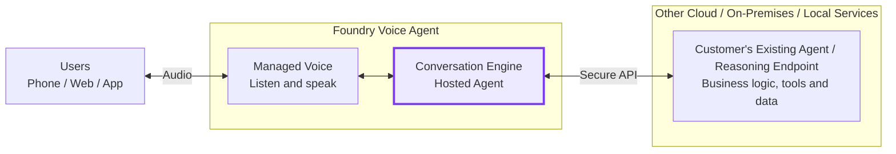

# Architecture guideline: Voice-enable an existing agent or reasoning system

**Status:** Reference design

**Audience:** Solution architects, customer engineering teams, and implementation partners

**Scope:** Foundry Voice Agent with a Hosted Agent conversation engine connected to an existing customer backend

This document describes a recommended integration approach. It is not a runnable
sample, a portal template, or a guarantee of availability for every deployment
configuration. Validate current product capabilities and preview restrictions
before implementation.

## 1. Purpose and applicability

Customers may already operate conversational agents, reasoning systems, or
business services in another cloud, on-premises, or in local environments.
The objective is to add a managed voice interface without requiring them to
move or rebuild their existing business backend.

**Foundry Voice Agent provides the managed voice experience. A Hosted Agent
serves as its conversation engine and connects voice interactions to the
customer's existing agent or reasoning endpoint.**

This approach is suitable when the existing backend can accept text requests
and return text responses through an authenticated, reachable API. It is not
intended to provide disconnected or fully on-premises voice processing.

## 2. Architecture principles

| Principle | Guidance |
| --- | --- |
| Preserve existing investments | Retain the customer's agent, reasoning logic, workflows, tools, and data systems in their current environment. |
| Make the conversation engine the integration boundary | Use a compatible Hosted Agent to connect the voice runtime to the customer's API. |
| Separate voice processing from business execution | Let the voice runtime handle audio interaction and the customer backend enforce business rules and execute actions. |
| Avoid duplicate orchestration | Use a thin adapter when the existing agent already manages conversation and reasoning. |
| Make trust and data boundaries explicit | Define identity, network access, data processing, and operational ownership across the integration. |

## 3. High-level reference architecture

The **conversation engine** is the primary integration point. It receives
conversation turns from the managed voice runtime, invokes the customer system,
and delivers responses back to the voice runtime.

The diagram represents logical responsibilities, not physical deployment
boundaries. In particular, the Hosted Agent is a separately deployed component.
Phone, web, and app access depend on supported channel integrations.

## 4. Component responsibilities

| Component | Responsibility |
| --- | --- |
| Managed voice runtime | Speech recognition, speech synthesis, turn-taking, interruption handling, and configured voice behavior. |
| Conversation engine: Hosted Agent | Coordinate conversation turns, correlate sessions, adapt API contracts, authenticate backend requests, and handle responses and errors. |
| Existing customer agent or reasoning endpoint | Execute reasoning, business workflows, tools, authorization, and enterprise data access. |
| Client or channel integration | Establish the user connection and integrate the selected channel with the supported voice interface. |

### Conversation engine integration modes

| Customer capability | Recommended conversation engine behavior |
| --- | --- |
| Complete conversational agent | Act as a thin adapter. Forward user turns and session context; preserve the existing agent's reasoning and workflow ownership. |
| Reasoning endpoint or task-specific APIs | Provide the conversational coordination needed to invoke the endpoint and present its results. Clearly assign which system owns each workflow. |

The customer endpoint does not need to process audio or implement the voice
protocol. The Hosted Agent provides that adaptation. This design does not
require an additional reasoning model when the existing agent is sufficient.

## 5. End-to-end interaction

1. The user connects through a supported channel and speaks.
2. The managed voice runtime recognizes speech and sends the user turn to the conversation engine.
3. The conversation engine maps the turn to a backend session and calls the customer's endpoint using the configured identity.
4. The existing agent or reasoning system performs the work and returns response text, optionally streamed.
5. The managed voice runtime synthesizes the response and plays it to the user.
6. The integration records correlated operational events according to the approved logging and retention policy.

## 6. Interface and session requirements

### Voice runtime to conversation engine

The Hosted Agent must expose `invocations_ws` and implement Voice Live Bridge
Protocol 1.0, as described in the
[hosted conversation engine documentation](https://learn.microsoft.com/en-us/azure/foundry/how-to/voice-first-with-hosted-agent).
An arbitrary customer HTTP endpoint cannot be substituted directly for this
interface without a compatible adapter.

### Conversation engine to customer endpoint

Define an explicit API contract covering the following information. These are
design requirements, not prescribed product field names.

| Area | Required agreement |
| --- | --- |
| Request context | User input, backend session identifier, request correlation, and only the authorized identity or conversation context needed for execution. |
| Response handling | Response text suitable for speech, optional streaming semantics, completion indication, and structured error handling. |
| Conversation state | Which system owns history, how session identifiers are mapped, and when context expires or is deleted. |
| Concurrency | Whether turns are serialized and how a new user turn affects work already in progress. |
| Cancellation | How interruption, disconnect, cancellation requests, and late responses are handled. |
| Retry behavior | Timeouts, retry eligibility, and duplicate-request protection for actions that change state. |

Prefer streaming when supported end to end, but define a non-streaming response
path where required by the backend. Do not assume that interrupting speech
cancels a business operation. The backend must report the actual outcome of
work that may already have completed.

## 7. Deployment, security, and data boundaries

The existing customer system can remain in its current environment, provided
the Hosted Agent has an approved network path to its API.

| Backend location | Architectural consideration |
| --- | --- |
| Another cloud | Establish authenticated cross-cloud API access and assess network latency, egress policy, and data processing requirements. |
| On-premises or private network | Validate routing, DNS, firewall rules, and a supported private connectivity configuration for the selected hosting environment. |
| Local service | Provide an explicitly approved connectivity path. A cloud-hosted adapter cannot automatically reach a developer machine or local-only endpoint. |

Apply the following controls:

- Authenticate backend calls and enforce least-privilege authorization. Keep
  credentials server-side and use managed identity where supported.
- Treat user input and backend output as untrusted. Enforce business
  permissions and required confirmations in the customer backend.
- Protect state-changing operations against retries and duplicate execution.
  Do not rely on conversation instructions as the sole enforcement mechanism.
- Minimize the context sent across environments and redact sensitive content
  from operational logs.
- Review consent, audio and transcript processing, recording, retention,
  deletion, and regional requirements before enabling a channel.

Keeping business systems customer-hosted does not mean that all data stays in
that environment. Audio, transcripts, and returned results may be processed by
the voice platform. Private connectivity also does not, by itself, establish
data residency or compliance.

## 8. Operational guidance

Define an end-to-end latency budget across speech recognition, adapter
processing, network calls, backend execution, and speech playback. Measure
time to first audible response as well as total backend completion time.
Do not assume a latency target without testing the selected deployment.

Propagate correlation identifiers across the voice session, Hosted Agent,
and customer endpoint. Monitor session failures, backend errors, timeouts,
cancellation outcomes, and concurrent-session capacity without logging
unnecessary conversation content.

For slow or failed requests, provide an appropriate spoken status or failure
message. Never report success when the backend outcome is unknown. Assign
operational ownership and escalation paths for the voice layer, adapter,
network, and customer system.

## 9. Implementation and acceptance

1. Confirm channel support, subscription and region access, Hosted Agent availability, and current preview restrictions.
2. Document the customer API contract, workflow ownership, identity model, and data boundaries.
3. Implement the compatible Hosted Agent adapter and configure it as the Voice Agent's conversation engine.
4. Establish and verify authenticated network access to the existing backend.
5. Validate normal conversation, session isolation, interruptions, concurrent turns, slow responses, backend failures, and disconnects.
6. Verify permissions, confirmations, duplicate-request protection, and handling of uncertain action outcomes.
7. Evaluate representative calls for speech quality, latency, task completion, load, and operational visibility before expanding usage.

Acceptance criteria should be agreed for the target deployment. The design
is ready for adoption only after functional, security, data-handling, and
operational requirements have been verified. This guideline does not imply
production readiness or support for every private network or hosting option.

## 10. References

- [Use a hosted agent as the conversation engine](https://learn.microsoft.com/en-us/azure/foundry/how-to/voice-first-with-hosted-agent)
- [Configure a voice agent](https://learn.microsoft.com/en-us/azure/foundry/agents/how-to/configure-voice-agent)
- [Voice Live Bridge basic Python sample](https://github.com/microsoft-foundry/foundry-samples/tree/main/samples/python/hosted-agents/bring-your-own/voice-agent-target-agent/basic)
