# Evaluate an airline Voice Agent in Microsoft Foundry

This portal-first walkthrough evaluates a multi-turn reservation cancellation
request using a Voice Agent, a Python Code Interpreter toolbox, a simulated
caller, and a custom rubric. It adapts *A Step-by-Step Guide to Foundry Evaluation*
to the observed `Cancel_order` evaluation of `Airline-Agent:1` on October 30, 2026.

The agent collects identifiers, runs a **mock** reservation lookup, and explains
whether the booking meets a fixed 24-hour refund eligibility rule. It cannot
cancel a reservation or process a refund. This is a smoke test with fixed sample
data, not production airline policy, identity verification, or a customer benchmark.

## Reproduce the example

All source inputs and screenshots are included in this folder. You do not need
access to the original project, SharePoint guide, or original uploaded-file ID.
You do need your own enabled Foundry project and available model deployments.
This is a **portal walkthrough**, not a one-click cloud provisioning script.

1. Upload `airline_lookup_default.py` to a Code Interpreter toolbox.
2. Replace the uploaded-file path in the agent prompt, or generate ready-to-paste
   inputs with the helper below. Create a Voice Agent and attach the toolbox.
3. Upload `scenarios.jsonl`, create the five-dimension custom rubric, and follow
   the illustrated evaluation wizard. Only the final **Submit** starts a run.
4. Compare the returned conversation, scores, and tool traces with the example
   results. Generated conversations and judge scores can vary between runs.

From the repository root, validate the files without Azure access:

```powershell
python samples\foundry_evaluation\prepare_example.py --check
```

After uploading the Python file, substitute its **actual** mounted path below
(the example path is illustrative, not a valid file in your project):

```powershell
$uploadedPath = Read-Host "Paste the actual uploaded /mnt/data/... Python path"
python samples\foundry_evaluation\prepare_example.py `
  --uploaded-python-path $uploadedPath
```

The helper writes six files to the ignored `.generated` subfolder: the Python
tool, scenario JSONL, rubric JSON, evaluation settings checklist, rendered
`agent_prompt.txt`, and `rubric_generation_prompt.txt`. Paste the two text files
into the corresponding portal fields. It performs no uploads or Azure calls.
It refuses to overwrite an existing output folder; use `--output` with a new
local path for another preparation. If you named the toolbox differently, pass
`--toolbox-name` to keep the generated prompt and settings consistent.

You can also use this directory on its own: run the same helper from inside it
without the `samples\foundry_evaluation\` prefix.

## Files and workflow

| File | Purpose |
| --- | --- |
| [agent_prompt.md](agent_prompt.md) | Agent instructions from the example, with the upload-specific Python path replaced by a placeholder. |
| [airline_lookup_default.py](airline_lookup_default.py) | Original sample Python implementation supplied by the run owner; no network calls or reservation mutations. |
| [scenarios.jsonl](scenarios.jsonl) | The single scenario from dataset `flight_info_retrieval4`, version `1`. |
| [rubric.json](rubric.json) | Documentation snapshot of the observed rubric dimensions, weights, generation prompt, and threshold; **not** an API import payload. |
| [evaluation_settings.json](evaluation_settings.json) | All portal configuration values in one checklist; **not** an API import payload. |
| [prepare_example.py](prepare_example.py) | Offline input validation and ready-to-paste prompt generation; no packages required. |
| [test_airline_lookup_default.py](test_airline_lookup_default.py) | Offline checks for the sample tool, including the 24-hour boundary. |
| [test_prepare_example.py](test_prepare_example.py) | Offline checks for preparation, path substitution, and overwrite protection. |
| [screenshots/](screenshots/) | Fifteen real Foundry captures embedded alongside the steps below. |

Only the **Python file** and **scenario JSONL** are uploaded as files. The agent
prompt is pasted into **Instructions**, and the rubric is entered in the
evaluator editor. The settings JSON is a checklist, not a file to upload to
Foundry. Do not upload the README, tests, screenshots, or helper as agent tools.

Screenshots show the example's preview portal. The wizard was staged for
documentation **without submitting** another run; its target is explicitly
pinned to version `1`. Result screenshots come from the original completed run.
Captures exclude the account header, some trailing whitespace is cropped, and
the run author's name is visibly redacted. Scores and configuration values
have not been altered.

```text
Scenario JSONL -> simulated caller <-> Airline-Agent
                                          |
                                   Code Interpreter
                                          |
                               airline_lookup_default.py

Conversation messages -> custom rubric + judge model -> scores and reasons
Tool execution traces -> separate inspection of arguments, execution, and output
```

The simulator, agent, and judge have different roles. Scenario instructions are
for the simulated caller, not the agent's system prompt. The rubric grades the
observed conversation; it does not execute the reservation tool.

## Prerequisites

- A Foundry project with access to Voice Agents, Code Interpreter/toolboxes,
  conversation simulation, and custom rubric evaluation. The example used a
  preview portal; labels and feature availability can differ by project or region.
- Permission to create an agent, upload a Python file and scenario dataset,
  configure an evaluator, and run evaluations. See
  [evaluation permissions](https://learn.microsoft.com/azure/foundry/observability/how-to/evaluation-permissions).
- Available agent, simulator, and judge models. The names below record the
  example's configuration, not a guarantee of availability in another project.
- Approved sample data and mock tools only. A simulated caller can invoke the
  target's tools; simulation is not a sandbox for production side effects.
- Python 3.10+ only if running the offline checks. The portal walkthrough does
  not require installing this repository's SDK dependencies.

## 1. Create the sample toolbox

In **Build > Tools > Toolboxes**, create a toolbox named `airline-refund-python`.
Add **Code interpreter**, upload [airline_lookup_default.py](airline_lookup_default.py),
wait for the file status to become **Processed**, and save the toolbox. The
observed run used toolbox version `1`.

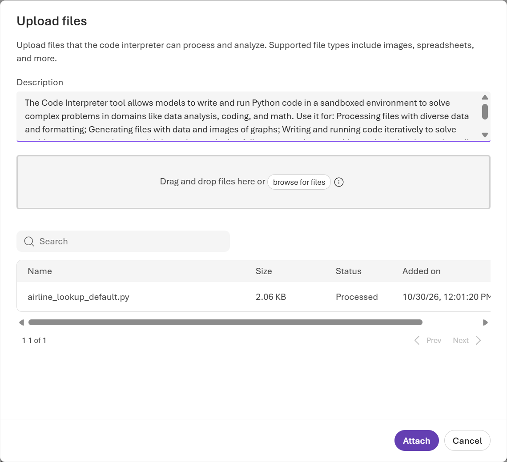

Record the exact mounted path assigned to the uploaded Python file. It is an
upload-specific path under `/mnt/data/`, not the repository path. Do not copy
another project's file ID or assume the file mounts at its original basename.
See the [toolbox documentation](https://learn.microsoft.com/azure/foundry/agents/how-to/tools/toolbox)
for the current setup experience.

**If the upload dialog shows only the filename:** before installing the final
agent instructions, use a disposable setup agent/preview with the same toolbox.
Ask it to execute the following **in Code Interpreter** and return the printed
path. This is a setup-only discovery step and may incur inference/tool costs;
it is not part of the evaluated conversation.

```python
from pathlib import Path

matches = sorted(Path("/mnt/data").glob("*airline_lookup_default.py"))
if len(matches) != 1:
    raise RuntimeError(f"Expected one uploaded sample file; found {len(matches)}")
print(str(matches[0]))
```

Use the printed path for the preparation command, then install the final prompt.
Do not guess a path when no match is returned. Remove unintended/duplicate
attachments if multiple matches are returned. The final evaluation prompt
deliberately prohibits filesystem discovery; the agent under test must use
the configured exact path instead. Pin the saved agent version containing
that final prompt, even if its version number differs from the screenshots.

The file exposes two functions **inside Code Interpreter**, not two client-side
function tools:

| Function | Inputs | Output |
| --- | --- | --- |
| `lookup_reservation` | `user_id`, `reservation_id` | Fixed customer/booking data, echoed IDs, and the fixed reference time. |
| `check_refund_eligibility` | `created_at`, `reference_time` | Eligibility, booking age, reason, and flags confirming no reservation/refund mutation. |

The fixed record contains:

```json
{
  "mock": true,
  "customer_name": "Emma Kim",
  "reference_time": "2024-05-15T15:00:00",
  "time_zone": "EST (benchmark fixed time)",
  "reservation": {
    "user_id": "emma_kim_9957",
    "reservation_id": "EHGLP3",
    "created_at": "2024-05-04T23:12:06"
  }
}
```

`lookup_reservation` accepts any string containing at least one alphanumeric
character and echoes the supplied IDs. **It does not check whether those IDs
exist, match this customer, or belong together.** Its docstring is shorthand:
underscores and other punctuation are allowed, as in the sample user ID.

The timestamp strings are timezone-naive; the `time_zone` label is descriptive
metadata, not a timezone conversion. Eligibility uses the difference between
the two returned timestamps, not today's clock or a flight departure time.
Exactly 24 hours is eligible; strictly more than 24 hours is ineligible. The
sample booking is approximately `255.7983` hours old and therefore ineligible.

## 2. Configure the agent and its prompt

Create a test Voice Agent and attach the toolbox. The observed configuration was:

| Setting | Example value |
| --- | --- |
| Agent name / version | `Airline-Agent` / `1` |
| Agent model | `gpt-realtime-2.1` |
| Agent voice | `Marin` |
| Session-start greeting | `None` |
| Attached toolbox | `airline-refund-python`, version `1` |

Copy [agent_prompt.md](agent_prompt.md) into **Instructions**, replacing
`<UPLOADED_PYTHON_PATH>` with the exact path from step 1 before saving. The
original prompt refers to the toolbox as `airline_refund_python`; the portal
display name is `airline-refund-python`. Keep the instructions consistent with
the tool name exposed in your own project. The preparation helper makes that
substitution automatically.

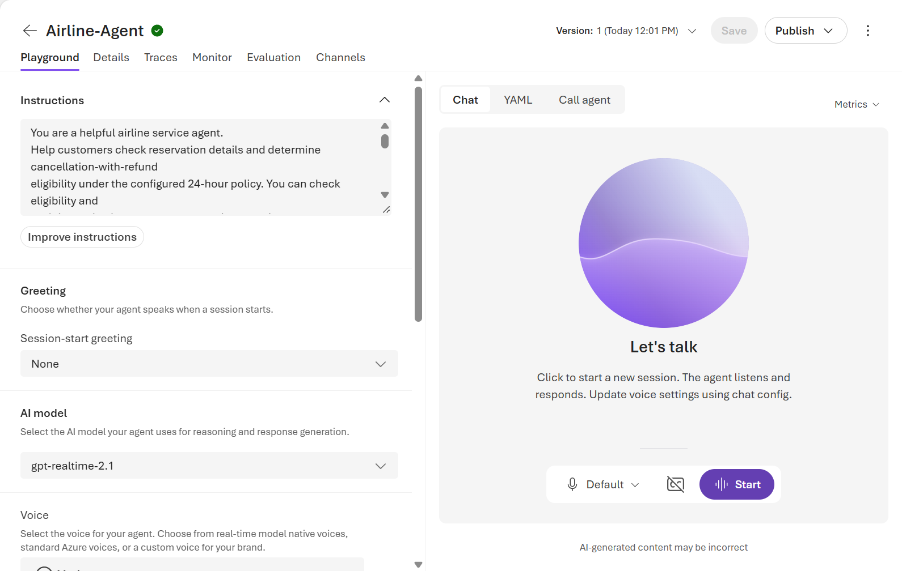

Select **Marin**, then use **Add a toolbox** to attach the saved toolbox version.
The toolbox should expose **Code interpreter** as shown below. Do not start a
microphone session just to configure these settings.

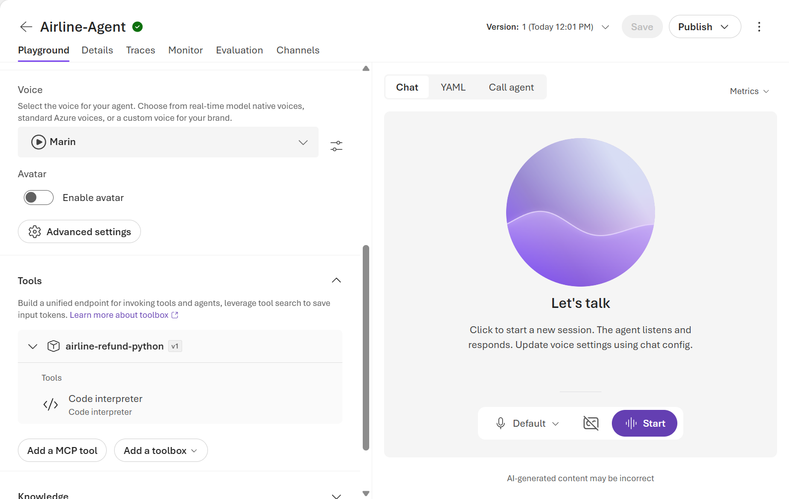

The prompt requires the agent to collect both IDs before execution, remember
previous answers, interpret clearly spoken identifier punctuation, and ask for
clarification rather than invent values. It requires loading the uploaded file
with `runpy.run_path`, running both functions, and using their actual outputs.
It also forbids claiming that a cancellation or refund was processed.

For example, the intended Code Interpreter execution after collecting both IDs
is equivalent to the following. Replace the placeholder before using it:

```python
import json
import runpy

functions = runpy.run_path("<UPLOADED_PYTHON_PATH>")
record = functions["lookup_reservation"](
    user_id="emma_kim_9957", reservation_id="EHGLP3"
)
eligibility = functions["check_refund_eligibility"](
    record["reservation"]["created_at"], record["reference_time"]
)
print(json.dumps({"lookup": record, "eligibility": eligibility}))
```

These are illustrative tool-execution instructions, not a script that creates
the Foundry agent. Save and record the exact agent version used for evaluation.

## 3. Define the simulated task

Upload [scenarios.jsonl](scenarios.jsonl) as the simulation dataset. It preserves
the observed fields: `test_case_id`, `test_case_description`, and
`simulation_configuration.desired_num_turns`. Each JSONL line is one scenario.
Use **Download sample** in your portal if its expected schema differs.

The original dataset is named `flight_info_retrieval4`, version `1`. In a new
project, upload the included `scenarios.jsonl` and give the dataset that name,
or consistently select your own name in the evaluation wizard. The local
filename does not need to match the original service-generated filename.

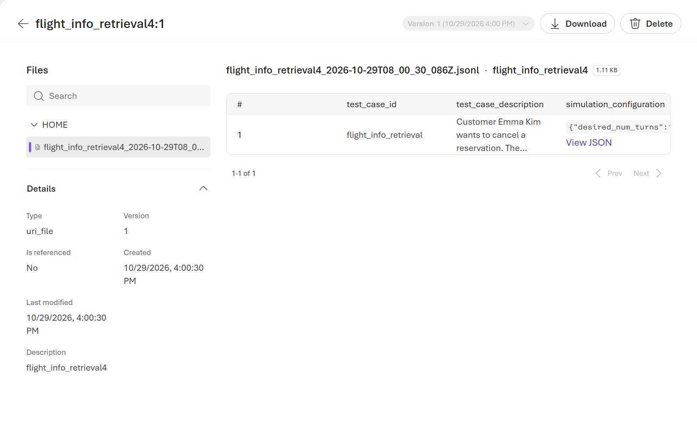

The task ID remains `flight_info_retrieval` to match the original run, although
the task is **reservation cancellation/refund eligibility**, not flight search.

| Task element | Expected behavior |
| --- | --- |
| Opening | Caller says only that they want to cancel a reservation. |
| Identifier collection | Caller supplies at most one new detail per reply, only when asked. |
| Known sample details | Emma Kim; user ID `emma_kim_9957`; reservation ID `EHGLP3`. |
| Hidden information | Caller must not disclose the booking timestamp or elapsed booking age. |
| Agent tool use | Look up using both IDs; calculate eligibility from returned `created_at` and `reference_time`. |
| Expected explanation | Booking is outside the 24-hour refund window; no claim of cancellation or refund execution. |

Keep the scenario and ground truth out of the agent prompt. This prevents the
caller from simply handing the agent the eligibility answer. It does not by
itself prove that the agent executed the required tool.

The scenario requests `desired_num_turns: 10`; it is not a fixed transcript or a
guarantee of ten completed exchanges. The observed conversation ended after four
user/assistant exchanges.

## 4. Configure the custom evaluator

In **Evaluations > Evaluator catalog**, create a **Rubric** evaluator, or select
the existing `flight_info_retrieval` evaluator in the original project.
The inspected catalog version was `4`. Set the **pass score threshold to `0.5`**
and copy the dimensions and weights from [rubric.json](rubric.json).

For a new project, use evaluator name `flight_info_retrieval` and display name
`flight info retrieval`. To generate a starting rubric, select **Rubric**, enable
**Auto-generate rubric**, choose an available generation model, and paste
`generation_prompt` from `rubric.json` (or the generated text file). After
generation, edit/add/remove dimensions until the five IDs, descriptions, and
weights below match the included JSON, then save. Do not assume the generated
output matches automatically. A new evaluator's first saved version can be `1`;
`4` is the inspected original version, not a version you must manufacture.

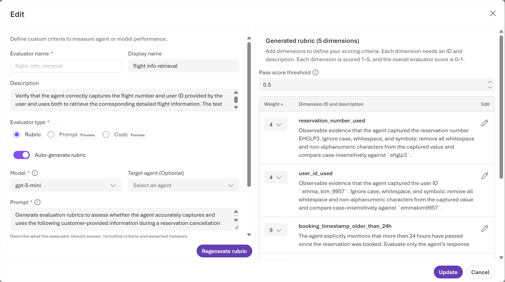

The JSON also preserves the original rubric-generation prompt. Auto-generation
can produce different dimensions, so inspect and edit its output rather than
assuming that regenerating the prompt recreates this rubric.

| Dimension | Weight | Criterion |
| --- | --- | --- |
| `reservation_number_used` | 4 | Observable capture of `EHGLP3`, compared case-insensitively after removing whitespace and non-alphanumeric characters. |
| `user_id_used` | 4 | Observable capture of `emma_kim_9957`, using the same normalization (`emmakim9957`). |
| `booking_timestamp_older_than_24h` | 9 | Agent explicitly says that more than 24 hours have passed since booking; evaluate its response. |
| `retry_and_error_handling` | 3 | If a transient lookup error/timeout/null occurs, retry with correct parameters or explicitly handle/report the failure. |
| `general_quality` | 5 | Always-applicable quality factors not covered by the other dimensions. |

Dimension scores range from `1` to `5`; overall rubric scores range from `0` to
`1`. A dimension can be **N/A** when its condition did not occur. Identifier
normalization is a grading rule, not permission for the agent to guess an ID or
rewrite tool arguments arbitrarily.

**Known gaps in the original rubric:** its catalog description still refers to
flight numbers, while its dimensions refer to reservations. Its generation
prompt asks about customer-name association and exact lookup arguments, but
there is no separate customer-name dimension and the two identifier dimensions
only require observable capture. Preserve this distinction when explaining the
run. A stricter follow-up evaluator should explicitly score tool execution,
arguments, returned data, and name association; that would be a new rubric,
not the rubric used for this result.

## 5. Create and run the evaluation

In **Evaluations > Create**, select the agent and configure the workflow below.
Do not submit until the target is a test agent, only mock tools are attached,
and you have reviewed inference costs.

| Setting | Observed example |
| --- | --- |
| Evaluation name | `Cancel_order` |
| Target | `Airline-Agent` (result row identifies version `1`) |
| Scope | Full conversations |
| Frequency | One time |
| Conversation data | Simulated data; `flight_info_retrieval4`, version `1` |
| Simulator model | `gpt-5.6-luna` |
| Simulated caller voice | `azure-standard`, `en-US-Ava:DragonHDLatestNeural` |
| Conversations per scenario | `1` |
| Maximum turns | `10` |
| Generated-conversation dataset persistence | Disabled in this run |
| Evaluator | Custom `flight_info_retrieval`, not the guide's suggested built-in evaluators |
| Judge model | `gpt-5.6-luna` |
| Messages mapping | `{{item.messages}}` |
| Tool definitions mapping | `{{sample.tool_definitions}}` |

### 5.1 Select the target

Choose **Agent**, search for your test agent, select its row, and use the version
selector to **Pin v1** (or your deliberately selected saved version). Select
**Next**. Do not accidentally select a similarly named agent.

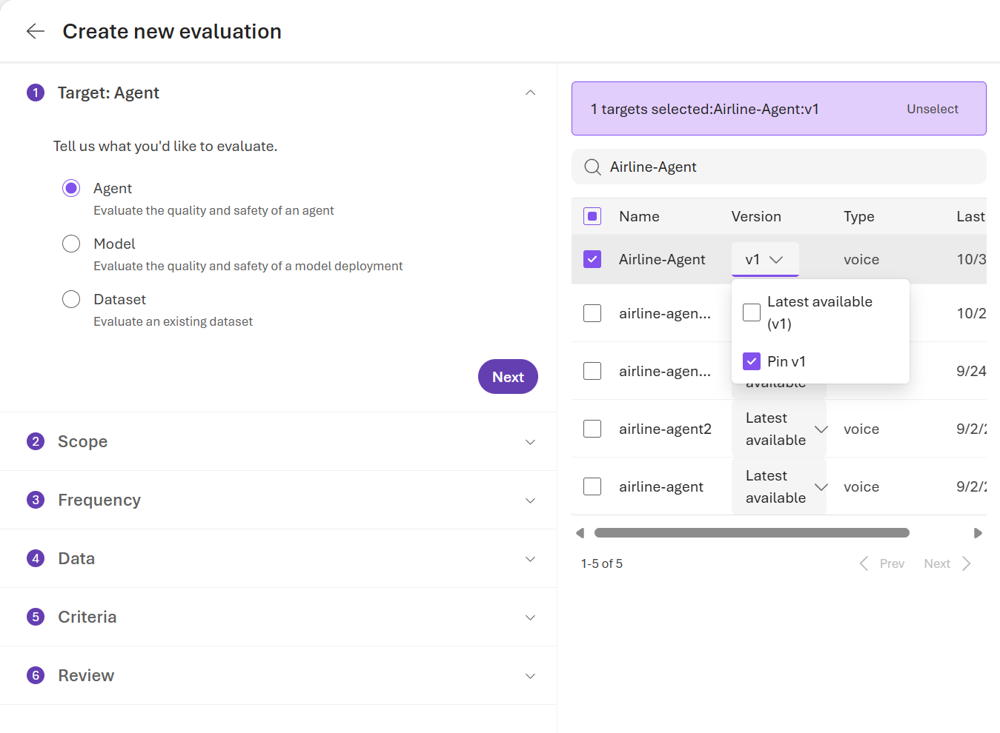

### 5.2 Choose the scope

Choose **Full conversations**, then **Next**. This grades the multi-turn
identifier-collection flow, not isolated query/response rows.

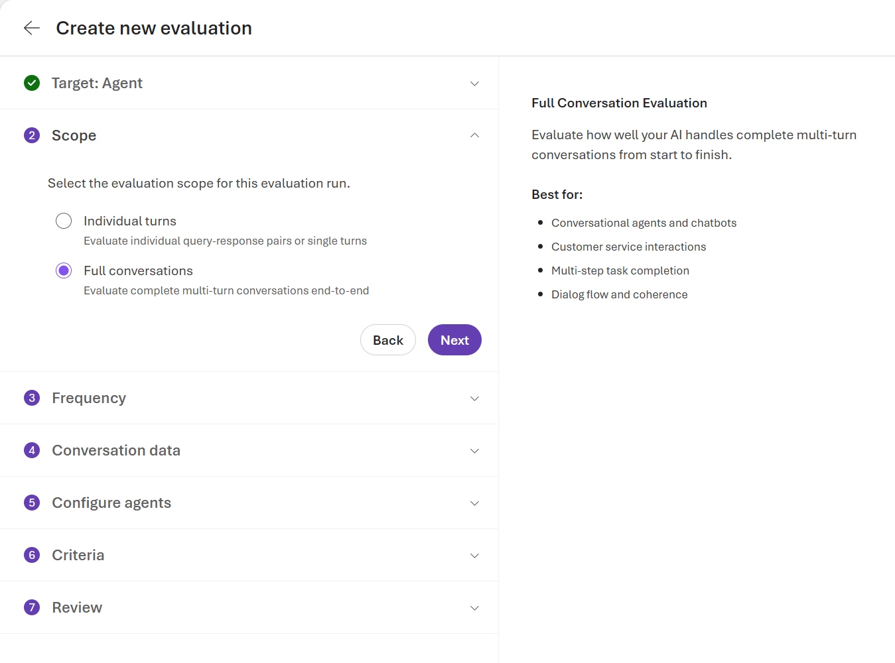

### 5.3 Choose the frequency

Choose **One time**, then **Next**. A recurring configuration is not needed to
reproduce this example.

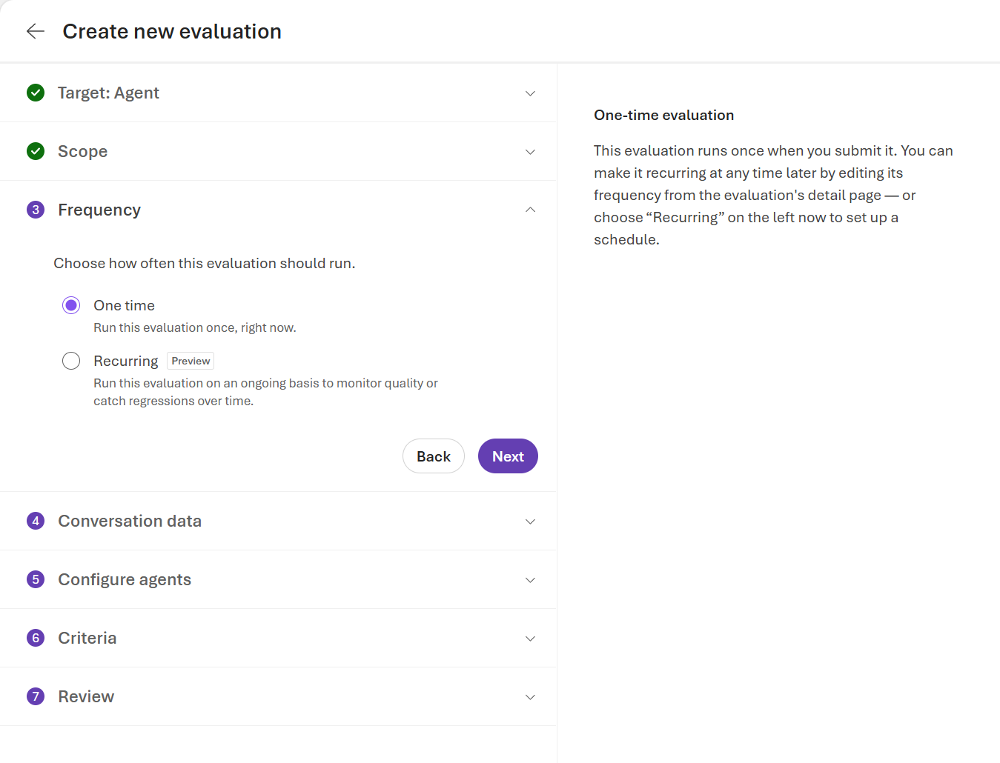

### 5.4 Select the scenario, simulator, and voice

Choose **Simulated data > Use a dataset**. Use **Upload dataset** for the supplied
`scenarios.jsonl`, or select the dataset already uploaded in step 3. Verify that
the preview contains `flight_info_retrieval` and `desired_num_turns: 10`.

Select the simulator deployment and **Ava Dragon HD Latest** voice. Under
**Simulation settings > Edit**, set **Conversations per test case scenario** to
`1`, set **Max turns per conversation** to `10`, and leave **Save conversations
as a dataset** unchecked to match the original run. Then select **Next**.

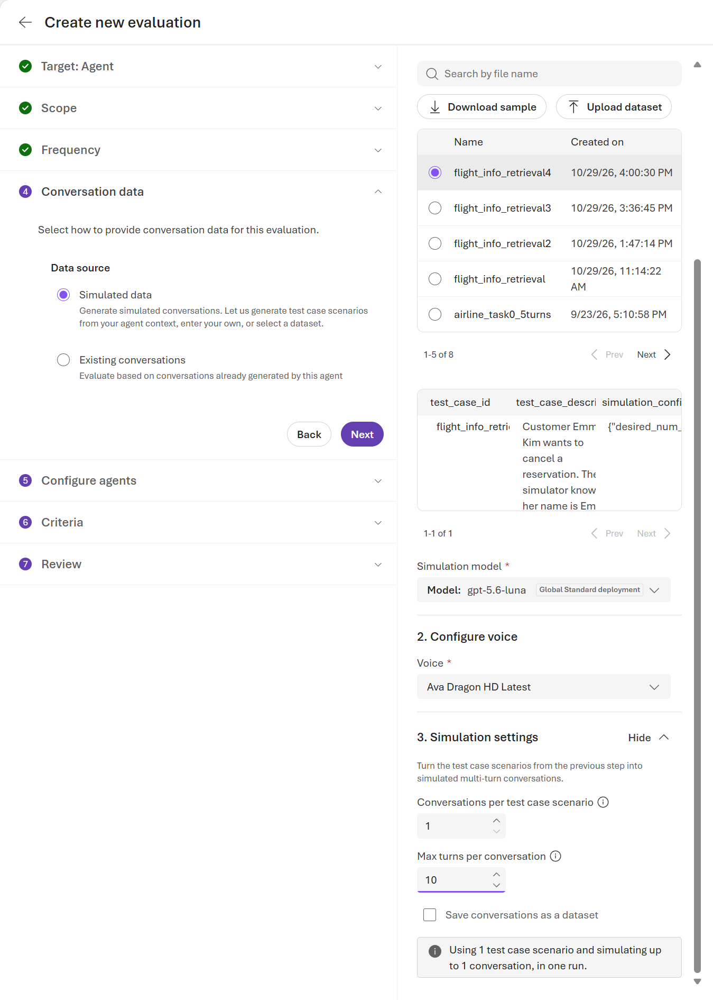

### 5.5 Keep the saved agent instructions

If **Configure agents** appears, leave the saved instructions unchanged and
select **Next**. This step is for an optional evaluation-specific custom prompt;
it is not where you paste the simulated caller scenario.

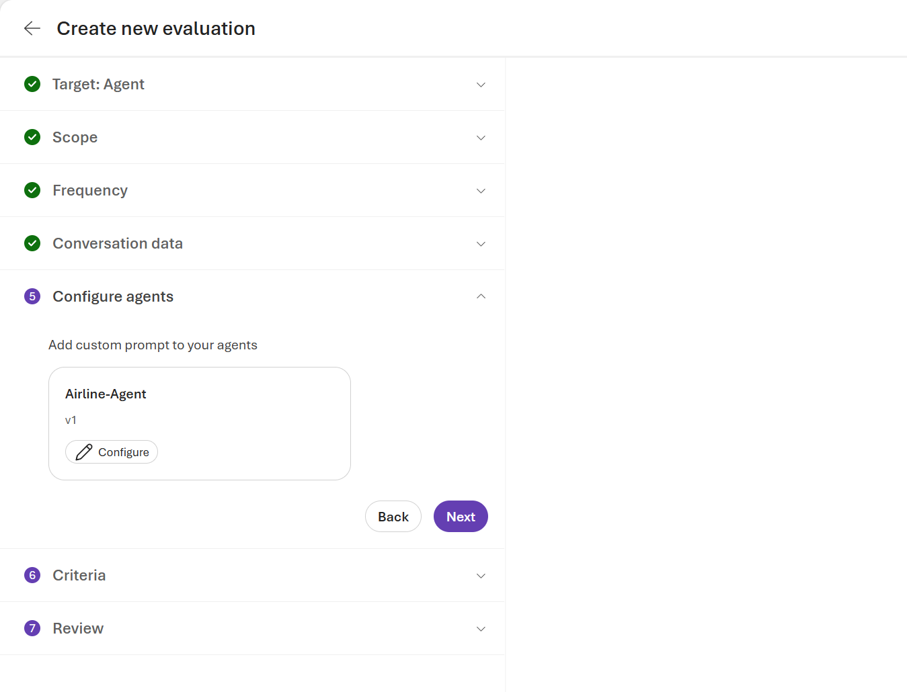

### 5.6 Select the judge and custom rubric

Choose the judge deployment. Clear any preselected recommended evaluators or
evaluator bundles, then select **only** `flight info retrieval`. Confirm
**Review selected (1)** so the result is comparable to this single-rubric run.

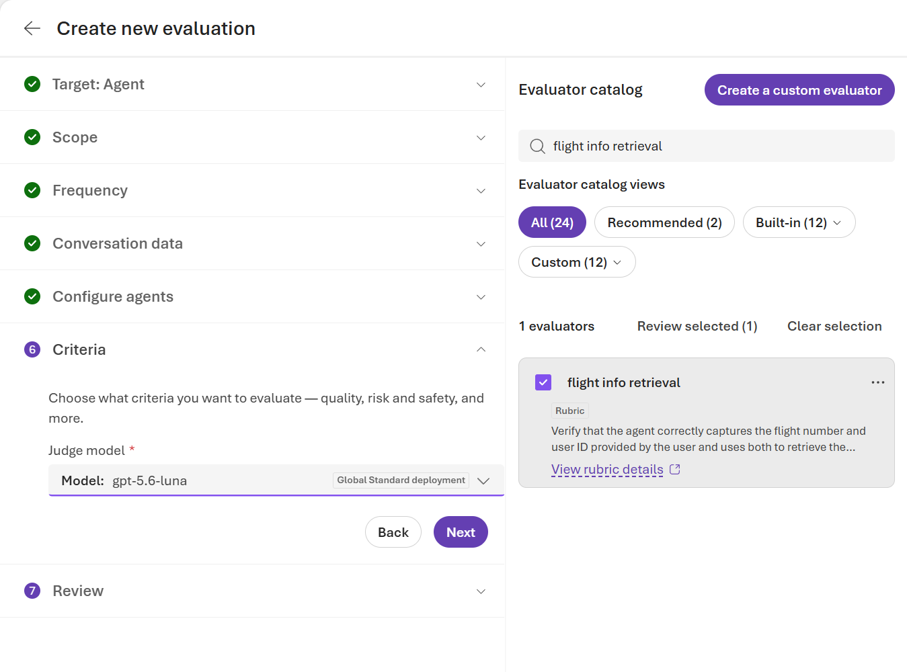

Open the selected evaluator's **...** configuration menu and expand
**Advanced settings**. Verify **Messages** is `{{item.messages}}` and **Tool
definitions** is `{{sample.tool_definitions}}`. The current editor also displays
**Response** as `{{sample.output_text}}` and **Query** as unavailable; the
original evaluation JSON stored the messages/tool-definitions mappings.
Keep the judge selection consistent and return to the wizard.

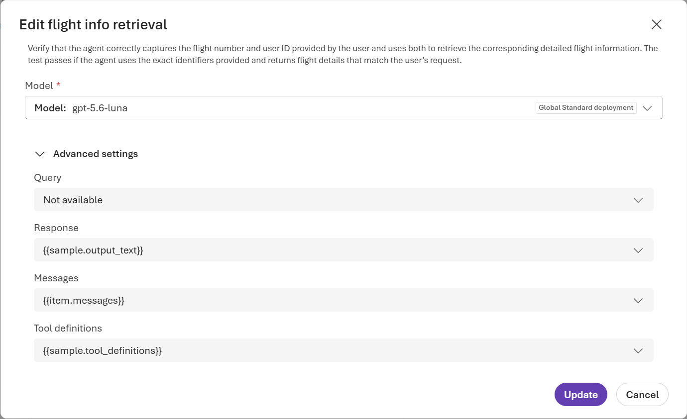

### 5.7 Review and submit

Select **Next**, enter an evaluation name such as `Cancel_order`, and review the
target/version, full-conversation scope, one-time frequency, and custom
evaluator. Recheck the scenario count, turn limit, simulator voice, and judge
settings before submitting.

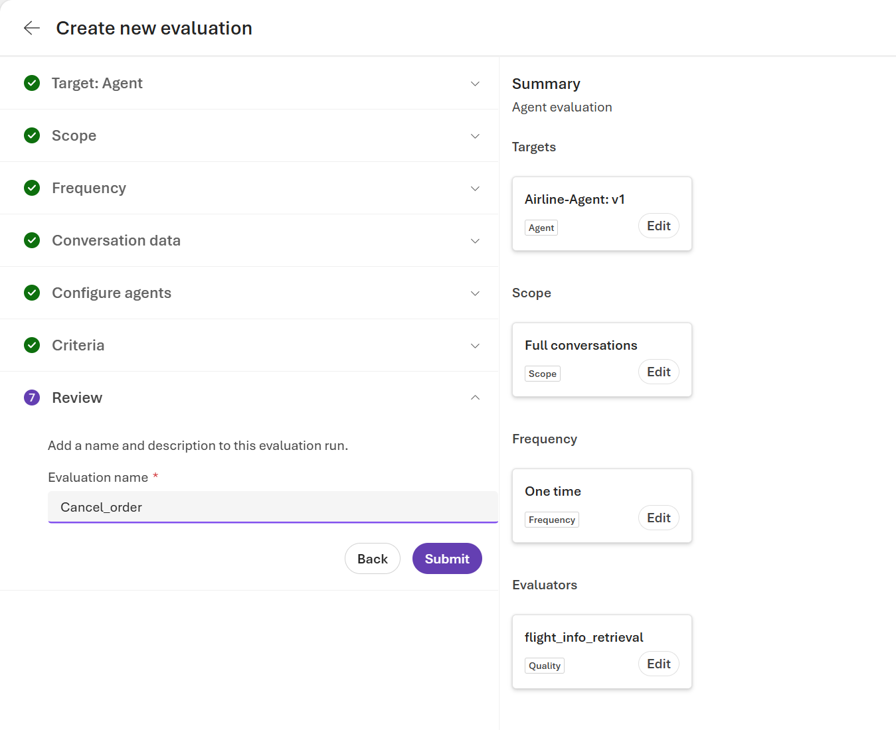

The agent model/voice, simulator model/voice, and judge model are separate
settings. The evaluator editor displayed `gpt-5-mini` for **rubric generation**;
the evaluation's raw JSON identifies `gpt-5.6-luna` as the **run's judge**.

Review the settings and select **Submit**. Wait for **Completed**, then open
the run to inspect its overall results and individual conversation. Completion
means processing finished, not that every criterion passed.

For an audit record, use **Raw JSON** on both the evaluation and run. The
original evaluation's `evaluator_version` was an empty string, and the run's
target `version` was `null`; the catalog and result row supplied the versions
reported above. For future runs, explicitly select/pin versions where supported
and retain the resolved configuration rather than assuming "latest" is stable.

For API-driven simulation with built-in task-completion/coherence scoring,
see the separate [simulation sample](../simulation_evaluation/README.md).
That sample is not a drop-in runner for this preview custom-rubric workflow.

## 6. Read the example results

Open the completed run to see its overall metrics and per-conversation table.

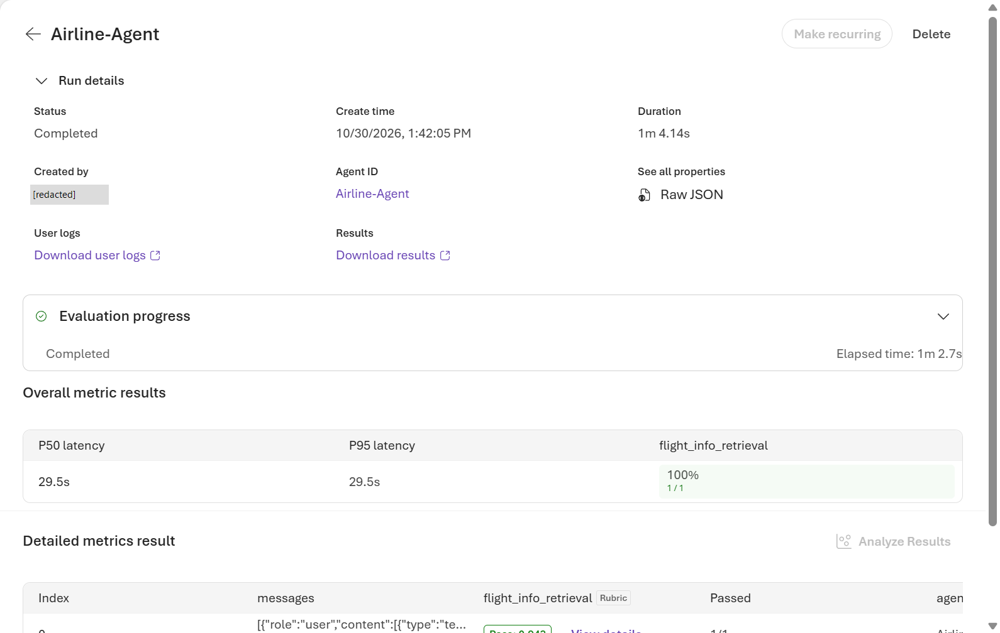

| Run result, October 30, 2026 | Observed value |
| --- | --- |
| Status | `completed` |
| Conversations | `1` |
| Passed / failed / errored / skipped | `1 / 0 / 0 / 0` |
| Aggregate pass rate | `100%` (`1 / 1`) |
| Conversation rubric score | `0.943` (detail panel rounded to `0.94 / 1.0`) |
| Run duration | `1m 4.14s` |
| Target P50 / P95 latency | `29.5s / 29.5s` (`29523.84 ms`, one sample) |

**The 100% pass rate and 0.943 rubric score are different metrics.** One
conversation passed the threshold; it did not receive a perfect quality score.
With only one latency sample, P50 and P95 coincide and do not establish a
population latency distribution or per-turn speech responsiveness.

The observed conversation proceeded as follows:

1. Caller requested cancellation without supplying identifiers.
2. Agent requested the user ID and reservation ID; caller supplied only the user ID.
3. Agent remembered that ID and requested the missing reservation ID.
4. After receiving `EHGLP3`, the agent reported the May 4, 2024 booking date and
   explained that it was outside the fixed 24-hour refund window.
5. Caller asked how to cancel even without a refund. Agent directed them to the
   airline/booking platform without claiming to perform the cancellation.

Open **View details** on the rubric result for the dimension scores and reasons:

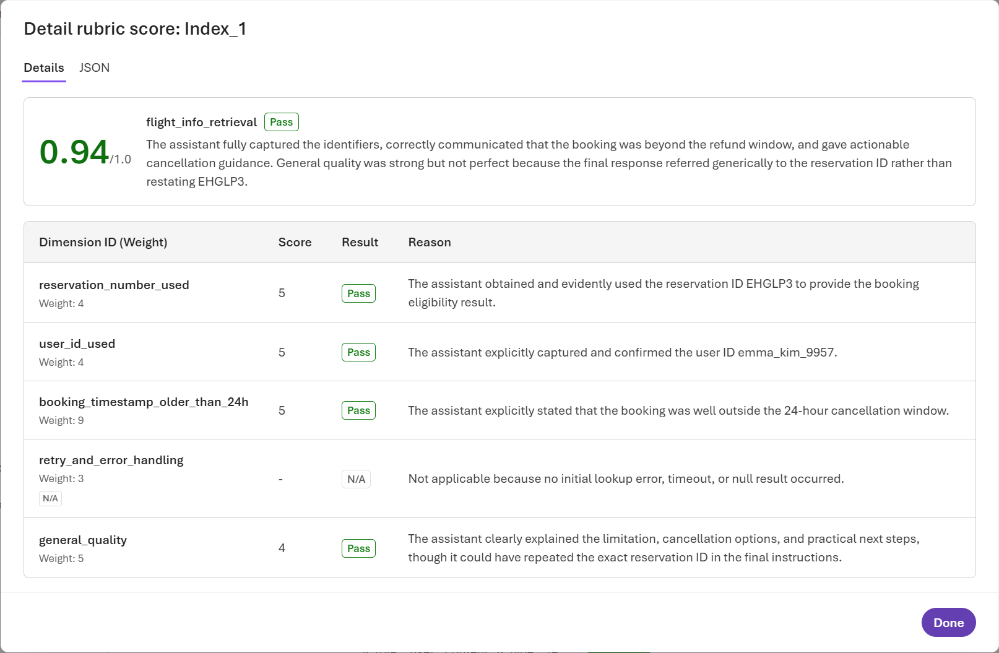

| Dimension | Score | Result / explanation |
| --- | --- | --- |
| `reservation_number_used` | 5 | Pass; judge credited capture/use of `EHGLP3`. |
| `user_id_used` | 5 | Pass; user ID was explicitly captured and confirmed. |
| `booking_timestamp_older_than_24h` | 5 | Pass; agent explicitly said the booking was outside the window. |
| `retry_and_error_handling` | N/A | No initial lookup error, timeout, or null result occurred. |
| `general_quality` | 4 | Pass; judge noted that the final guidance did not repeat the exact reservation ID. |

The retry dimension being N/A is **not evidence that retries work**. The displayed
messages contained user/assistant text, not an execution trace. The judge's
statement that the reservation ID was "evidently used" is a judgment, not an
independent verification of Code Interpreter execution.

Inspect the agent's tool traces separately for both supplied arguments,
`runpy.run_path` execution of the uploaded file, the returned timestamps, and
the eligibility result. The `tool_definitions` mapping alone does not establish
that these runtime traces reached the judge. Because the mock echoes arbitrary
IDs, a plausible response cannot prove ownership verification or correct lookup.
The caller also never supplied a customer name in this conversation; do not
report name collection as demonstrated.

Use **Download results** and **Download user logs** to retain authorized evidence
according to your project's policy. Keep raw conversations, internal portal
links, signed storage URLs, and credentials out of the repository.

## Offline checks

From the repository root, no third-party packages or Azure calls are needed:

```powershell
python -m unittest discover -s samples\foundry_evaluation -p "test_*.py" -v
```

These checks cover the deterministic toolbox functions and local input
preparation, not a new live evaluation. No new cloud run was submitted to
prepare this walkthrough.

## Limits and follow-up coverage

This single run demonstrates one multi-turn sample and a rubric judgment. It
does not measure transcription accuracy, pronunciation, audio quality,
interruption handling, or real cancellation processing. The results row showed
no audio artifact; this guide does not claim playback was assessed.

Before using this approach as a regression suite, add separate scenarios for
missing/changed identifiers, ambiguous spoken characters, a lookup failure,
within/exactly/beyond-24-hour bookings, and requests to execute cancellation.
Those are recommended extensions, not cases covered by the observed run. The
current mock has a fixed old booking and no transient-failure injection; testing
those branches requires deliberate new test fixtures and rubric expectations.
