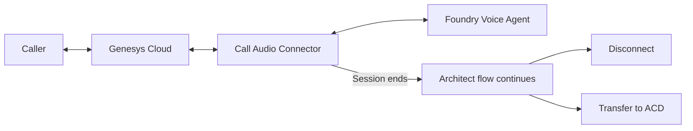

# Genesys Audio Connector with a Foundry Voice Agent

Connect a Genesys Cloud call flow to a Foundry Voice Agent. This sample creates
the Agent, generates the connection URI, and reads its Genesys call records.
The caller speaks with the Agent through Audio Connector. When the assistant
session ends, Architect continues with the next action configured in the flow.



## 1. Create the Agent

From the repository root:

```powershell
Set-Location samples/genesys_audio_connector
az login
$env:PROJECT_ENDPOINT = "https://<resource>.services.ai.azure.com/api/projects/<project>"
$env:AGENT_NAME = "genesys-voice-demo"

python genesys_audio_connector.py create --dry-run
python genesys_audio_connector.py create
```

The default model is managed `gpt-realtime`, with the `en-US-AvaNeural` voice.
To select a model deployment from the project, add these model options to the
preview and create commands:

```powershell
python genesys_audio_connector.py create --model-type self_deployed --model "my-realtime-deployment" --dry-run
```

The Agent answers briefly, listens when interrupted, and declares the
`end_conversation` system tool. When the caller finishes, it says a closing
message and invokes that tool in the same response.

The commands accept `--project-endpoint` and `--agent-name` directly as well.
On Linux or macOS, set the same environment variables with `export`.

## 2. Configure Audio Connector

Print the connection URI for the Agent:

```powershell
python genesys_audio_connector.py endpoint
```

The output has this form:

```text
wss://<resource>.services.ai.azure.com/api/projects/<project>/agents/genesys-voice-demo/endpoint/protocols/voice/telephony/genesys-audiohook?api-version=v1
```

In Genesys Cloud, add an **Audio Connector** integration and configure:

| Setting | Value |
| --- | --- |
| Connection URI | The URI printed above |
| API key credential | An active key for the Foundry account that owns the project |
| Audio | PCMU, 8 kHz, mono, external channel |

Enter the key in the integration's credential setting. Genesys sends it in the
`X-API-KEY` header during connection setup. Activate the integration.

## 3. Connect the Architect call flow

Add a **Call Audio Connector** action to an inbound call flow and select the
integration. Configure the flow to continue after the assistant session completes:

| Call experience | Next action in Architect |
| --- | --- |
| Finish after speaking with the assistant | **Disconnect** |
| Continue with a contact-center representative | **Transfer to ACD**, with the destination queue selected in Architect |

Choose the continuation for that flow and configure its failure path. Save and
publish the flow, then assign it to the Genesys inbound call route.

## 4. Try a conversation

Call the number assigned to the flow. For example:

1. Say, “Hello. Can you briefly explain what you can help with?”
2. Ask a follow-up question, or interrupt the answer to change the topic.
3. Say, “Thank you. I am finished with the assistant.”

The Agent says its closing message and ends the assistant session. Architect
then follows the configured continuation: disconnect the call or transfer it to
the selected queue.

## 5. Inspect call records

```powershell
python genesys_audio_connector.py calls
```

This retrieves the latest page of call records for the Agent filtered to the
Genesys provider. Use the provider call ID to correlate a record with its Genesys
conversation.

## 6. Clean up

Remove the sample action from the call flow and publish that flow before deleting
the sample Agent:

```powershell
python genesys_audio_connector.py delete --dry-run
python genesys_audio_connector.py delete
```

## Test the sample

```powershell
python -m unittest discover -s . -p "test_*.py" -v
```

The tests exercise the Agent payload, connection URI, authentication destination,
REST requests, and CLI previews with local test doubles.
