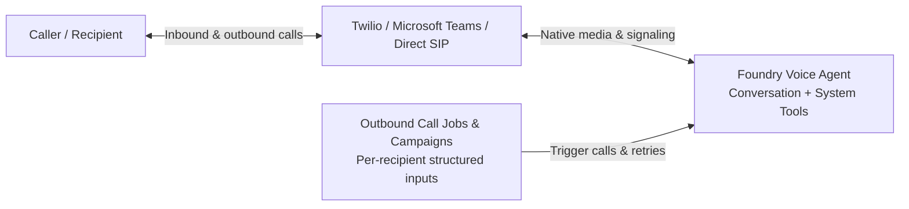

# Voice Agent Telephony, System Tools, and Outbound Calling

Connect one Foundry Voice Agent to inbound phone channels (**Twilio**, **Microsoft Teams Phone extensibility**, or **Direct SIP**), enable built-in phone **system tools** (`transfer`, `collect_dtmf`, `send_dtmf`, `send_sms`, and `end_conversation`), and place proactive **outbound calls and campaigns** using the `azure-ai-projects` Python SDK.



Every command supports `--dry-run` so you can inspect the exact SDK payloads locally before connecting live telephony resources.

## Setup

```powershell
Set-Location samples/telephony_voice_agent
python -m venv .venv
.venv/Scripts/pip install -r requirements.txt
Copy-Item .env.example .env
az login
```

`PROJECT_ENDPOINT` accepts `https://<resource>.services.ai.azure.com/api/projects/<project>` as well as the `_project` default-project alias.

## 1. Create the phone-ready Voice Agent

Creates a versioned Voice Agent configured with `structured_inputs` (providing sensible defaults for inbound callers and dynamic greetings for outbound reminders) and built-in phone system tools:

```powershell
.venv/Scripts/python telephony_voice_agent.py create --dry-run
.venv/Scripts/python telephony_voice_agent.py create
```

To route `transfer` to a SIP URI or Microsoft Teams queue instead of an E.164 number, pass `--transfer-destination "sips:desk@sbc.contoso.com"` or `--transfer-destination "teams:<resource-or-user-guid>"`.

## 2. Bind an inbound telephony channel

You can bind phone numbers or trunks in the Foundry portal (**Channels > Phone numbers**) or with the CLI:

```powershell
# Twilio phone number
.venv/Scripts/python telephony_voice_agent.py bind --provider twilio --connection-name contoso-twilio --phone-number +14255550100 --dry-run

# Microsoft Teams Phone extensibility (via Azure Communication Services)
.venv/Scripts/python telephony_voice_agent.py bind --provider teams --connection-name contoso-acs --resource-account-id 11111111-2222-3333-4444-555555555555 --dry-run

# Direct SIP trunk
.venv/Scripts/python telephony_voice_agent.py bind --provider sip --connection-name contoso-sip-inbound --allowed-caller +14255550100 --dry-run
```

Inspect or remove bindings when finished testing:

```powershell
.venv/Scripts/python telephony_voice_agent.py bindings
.venv/Scripts/python telephony_voice_agent.py unbind --binding-id "<binding-id>"
```

For low-level ARM `SipInbound` connection setup, mid-call operator controls, and Genesys Cloud BYOC routing, see [`../sip_voice_agent/README.md`](../sip_voice_agent/README.md).

## 3. Place a proactive outbound call

Reuse the same Voice Agent to place an outbound reminder call with personalized `structured_inputs` across Twilio, Teams Phone extensibility, or a `SipOutbound` connection:

```powershell
.venv/Scripts/python telephony_voice_agent.py call --to +14255550123 --customer-name Alex --dry-run
.venv/Scripts/python telephony_voice_agent.py call --to +14255550123 --customer-name Alex
.venv/Scripts/python telephony_voice_agent.py job --job-id "<returned-job-id>"
```

## 4. Launch an outbound campaign

Run a multi-recipient campaign from a JSON recipient list (1-100 recipients) or a Foundry project dataset (up to 1,000,000 rows) with automatic retry intervals:

```powershell
.venv/Scripts/python telephony_voice_agent.py campaign --campaign-name tuesday-reminders --recipients-file recipients.example.json --dry-run
.venv/Scripts/python telephony_voice_agent.py campaign --campaign-name tuesday-reminders --recipients-file recipients.example.json
```

## Run offline tests

```powershell
.venv/Scripts/python -m unittest discover -s . -p "test_*.py" -v
```
