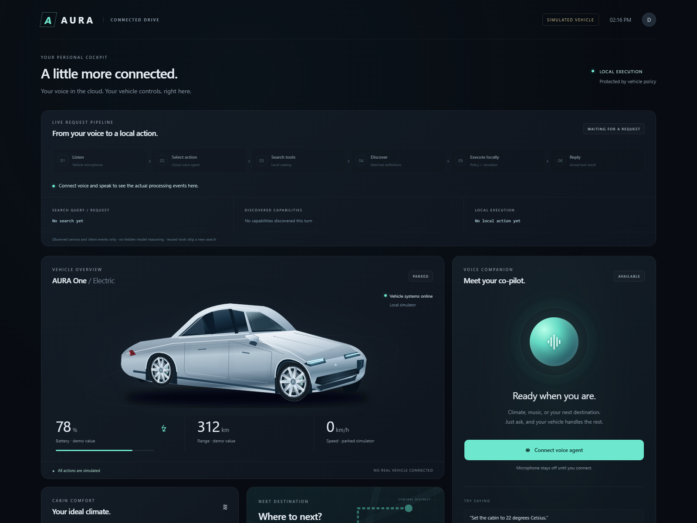
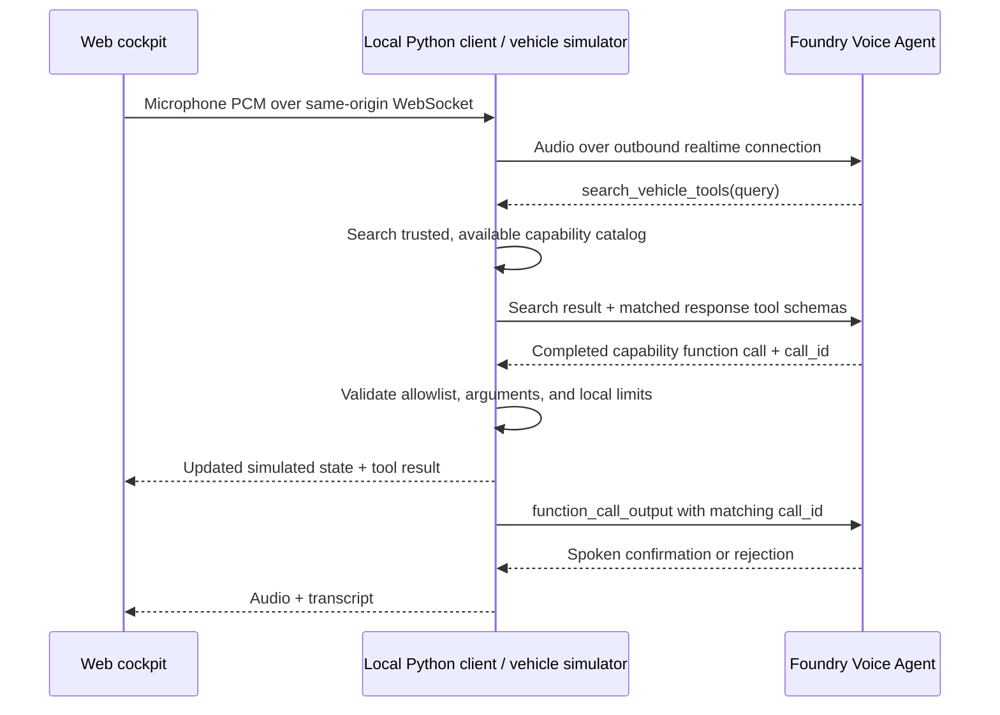

# Vehicle voice agent with local tools

A web cockpit demonstrating a **cloud Voice Agent that calls functions on the
vehicle's local side**. Talk to the agent to change cabin temperature, adjust
media volume, read vehicle status, or set a navigation destination. The dashboard
shows the local state and the conversation/tool execution log.



Each new user turn exposes only **`search_vehicle_tools(query)`**. The
agent searches the local catalog for the user's intent, the client exposes
matching function schemas for the next response, and the agent calls the
selected capability. Search and execution both appear in the dashboard log.

The **Live request pipeline** shows observed listening, cloud action selection,
catalog search, discovered definitions, local execution, and reply generation.
It displays the actual search query, expandable schemas, and local success or
rejection results. Repeated vehicle requests search again; ordinary conversation
skips tool execution. These are service/client lifecycle events, not hidden
model reasoning. "Response ready" means generation completed, not that speaker
playback has finished.

**Simulator only:** no real vehicle, CAN bus, navigation service, music playback,
or driving controls are connected. Battery (78%), range (312 km), speed (0 km/h),
and the map are explicitly illustrative. Climate, volume, and destination are
interactive, in-memory simulator state.

## Architecture



The Python process represents software running on the vehicle. Azure credentials
and vehicle implementations never reach the browser. The vehicle initiates the
cloud connection; no publicly accessible vehicle endpoint or remote MCP server
is needed. Manual dashboard controls use the same local validation as agent calls.

## Run the web cockpit

Requires Python 3.11+. The standalone web sample supports native Windows
PowerShell and Linux/macOS; it does not require the repository portal or WSL.
Current Edge or Chrome is recommended for browser audio.

From the repository root, in PowerShell:

```powershell
Set-Location samples\vehicle_local_tools
python -m venv .venv
.\.venv\Scripts\python.exe -m pip install -r requirements.txt
Copy-Item .env.example .env
.\.venv\Scripts\python.exe server.py --demo
```

Open **http://127.0.0.1:8765**. Offline mode supports the dashboard controls
without Azure, microphone access, or an AI model. It does not pretend to
recognize spoken requests.

For cloud voice, stop the demo with Ctrl-C, set your Foundry Project endpoint,
model, and output voice in `.env`, then run:

```powershell
az login
.\.venv\Scripts\python.exe server.py
```

Click **Connect voice agent**, grant microphone permission, and use a headset.
Audio capture begins only after the cloud session is ready. Disconnect stops
capture and playback. Speak naturally and pause to finish your turn.
**Talk over the reply to interrupt it.** Server VAD detects the new speech;
the browser stops queued and scheduled audio, and the local client cancels any
active cloud response. Late audio from the interrupted response is discarded.
The next response waits for cancellation and playback-position acknowledgement.

The browser reports how much of each interrupted audio item was played. The
client validates those positions and sends `conversation.item.truncate` for
unheard speech so cloud conversation context does not retain an unplayed reply.
Already executed vehicle actions and their tool results are not undone.
Microphone echo cancellation is requested, but a headset is still recommended.
Terminal microphone mode remains turn-serialized; browser playback
acknowledgements and barge-in apply to the web cockpit.

On Linux/macOS, use `python3 -m venv .venv`, `.venv/bin/python`, and
`cp .env.example .env`. Browser mode does not use PyAudio. For terminal
microphone mode, also run `python -m pip install "PyAudio>=0.2.14,<0.3"` in the
virtual environment; Linux/macOS may require system PortAudio development
packages before installing PyAudio.

Example requests:

- "What is the cabin temperature?"
- "Set the cabin to 22 degrees Celsius."
- "Turn the media volume down to 15 percent."
- "Navigate to Central Library."
- "Set the volume to 100 percent." — rejected by local policy.

The navigation tool stores a destination string only. It does not calculate a
route, geocode an address, or provide an ETA. Do not use this UI while driving.

## Tool contracts and local authority

| Function | Locally enforced behavior |
| --- | --- |
| `search_vehicle_tools(query)` | Search the local catalog by intent; return at most three available definitions. Does not change vehicle state. |
| `get_vehicle_status()` | Return the current simulated climate, volume, and destination. |
| `set_cabin_temperature(temperature_c)` | Accept finite numbers from 16 to 30 Celsius. |
| `set_media_volume(volume_percent)` | Accept integers from 0 to 60. |
| `start_navigation(destination)` | Accept a nonempty string of at most 200 characters without control characters. |

`vehicle.py` owns state, tool schemas, and policy. Schemas help the model choose
arguments, but local code validates them independently. Unknown functions,
unexpected fields, booleans as numbers, duplicate JSON keys, and invalid values
are rejected. Errors are returned as `ok: false`; the agent must not claim success.

### Local capability discovery

Search ranks intent words against trusted function names, descriptions, and
curated synonym tags (for example, "cooler" matches cabin temperature). Only
capabilities in the dispatcher's `available` set can be discovered or executed.
An empty result explicitly means no matching capability; it is not permission
to invent one.

The client puts matched schemas in `response.create(..., tools=[...])`; sending
schemas merely as search-result text is not sufficient. Up to twelve recently
discovered definitions remain available within the current user turn, then are
cleared before the next turn's response. The dispatcher
independently rejects execution of undiscovered or unavailable capabilities.
Reconnect starts a fresh discovery session while preserving local vehicle state.
Manual dashboard controls are direct local UI actions and do not require agent
discovery, but retain the same argument validation and availability checks.

The shipped catalog has four vehicle capabilities plus search. Extend `tools()`,
`SEARCH_TAGS`, and the approved simulator/OEM adapter together for a larger
catalog. This is a local discovery pattern, not a Foundry-managed remote Toolbox.
It adds a search tool round trip on every vehicle request, including repeated
requests. No vector database or external search service is needed.

`vehicle_voice_agent.py` executes only calls from **completed** responses, never
partial argument events. It returns the original `call_id` and requests another
response after submitting the result. Repeated call IDs return cached results;
conflicting reuse ends the session. Parallel tool calls are rejected before any
of them execute. Eight consecutive tool rounds, eight queued utterances, and
1000 cached calls bound sample workloads.

`server.py` is loopback-only, rejects cross-origin browser actions, allows one
voice session, and relays browser PCM through the Projects SDK. The browser uses
24 kHz mono PCM16 through an AudioWorklet and requires a browser supporting a
24 kHz AudioContext. Audio queues are bounded; upload/playback lag ends the voice
session explicitly instead of silently dropping frames.

Cloud audio can be generated faster than real-time playback. The browser keeps
a bounded PCM queue (up to 120 seconds including scheduled audio) and schedules
short chunks only about 250 ms ahead, rather than disconnecting on normal replies
longer than ten seconds. Paused browser audio produces a distinct actionable
error. Disconnect discards queued and scheduled speech.

Audio output includes response/item IDs and a playback generation. Interruption
increments the generation and clears both the server output queue and the
browser playback queue; obsolete frames are ignored even if they were already
in transit. Playback acknowledgements are bounded and validated against audio
actually produced by the service. An acknowledgement timeout ends the session
explicitly rather than allowing unsynchronized conversation context.

The entry points configure UTF-8 console output on Windows so multilingual
transcripts and tool results cannot terminate a session through legacy console
encoding errors.

## Adapting to an actual vehicle

Replace `SimulatedVehicle.execute()` with an adapter to **approved OEM/OS
services**, keeping allowlisting and validation in the local process. Add
independent authorization, occupant identity/permissions, vehicle-state checks,
and local confirmation policy as required by each operation.

The loopback demo is not a production vehicle gateway. It has no occupant
authentication or durable audit store. Do not expose it to a network. Production
implementations need appropriate device identity, protected credential storage,
transport authentication, timeouts, and durable idempotency/outcome reconciliation
across reconnects. This sample's call cache lasts only for the local process;
new calls are not deduplicated merely because they have similar arguments.

Do not expose arbitrary shell execution, raw CAN commands, steering, braking, or
other safety-critical driving operations through this conversational tool path.
Keep essential vehicle functions available independently of cloud connectivity.

## Privacy, cost, and lifetime

Cloud mode sends microphone audio, transcripts, tool arguments, and tool results
to Azure. Destination text can be sensitive. `store=False` disables configured
conversation persistence; it is not a claim of zero service telemetry or
retention. The browser displays up to 100 log entries; server output includes
tool results and errors. Do not use sensitive real vehicle data in this demo.

The first web voice connection creates and enables a uniquely named Azure agent;
later connections reuse it and the server's authenticated SDK client. Setup
progress appears beside the connect button, and phase timings appear in the
server log. The terminal variant creates an agent per run.
**Agents are retained after disconnect**, including setup failures after
creation, and cloud sessions incur service charges. Delete unused agents in
Foundry. The local vehicle state is shared by cockpit clients and survives
voice reconnects, but resets when the Python server restarts.

## Terminal and validation modes

The terminal variant remains available:

```powershell
# No cloud, audio libraries, or Azure credentials required:
python vehicle_voice_agent.py --demo

# Cloud tool loop without microphone or playback:
.\.venv\Scripts\python.exe vehicle_voice_agent.py --text "Set cabin temperature to 22 Celsius." --text "What is the cabin temperature?"

# Terminal microphone and speakers:
.\.venv\Scripts\python.exe vehicle_voice_agent.py

.\.venv\Scripts\python.exe -m unittest discover -s . -p "test_*.py" -q

# Browser playback regression tests (Node.js 22.7+; no npm packages):
node --test test_audio.mjs
```

Tests cover local policy, duplicate handling, failed/partial responses, matching
tool output IDs, text-mode feedback, bounded audio queues, and HTTP origin
checks. A real Azure connection and physical microphone/speaker behavior require
separate live validation; offline tests do not establish either.
