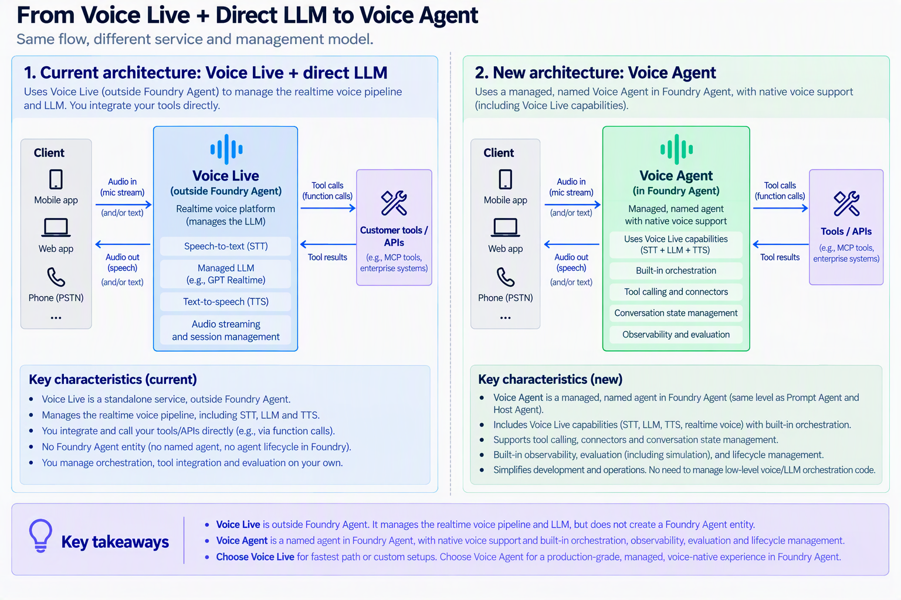

# Migrate Voice Live to Voice Agent

**We recommend migrating from Voice Live with a direct LLM to Voice Agent.**
Voice Agent retains Voice Live capabilities and adds a managed, named agent in
Foundry: migration is about gaining agent features, not losing the voice
experience or your local function integrations.



Keep real-time audio, speech recognition and synthesis, turn-taking,
interruptions, and function calls while adding reusable, versioned
configuration, Foundry tools and connectors, knowledge integration,
conversation state management, observability, evaluation, and agent lifecycle
management. Confirm model, voice, region, and access availability in your
target Project; availability and configuration depend on the selected pipeline.
This sample demonstrates preservation of the settings and local function flow
below, rather than exercising every additional agent capability.

Two Python files demonstrate the same **cascaded pipeline: Azure Speech STT ->
GPT-4.1 mini -> Azure TTS**. This is not a speech-to-speech realtime model.

| Start with | Migrate to |
| --- | --- |
| [`voice_live.py`](voice_live.py): connect to Voice Live, then send session settings. | [`voice_agent.py`](voice_agent.py): save those settings in a Voice Agent, then connect by agent name. |

Both use `gpt-4.1-mini`, `azure-speech` recognition in `en-US`,
`en-US-Ava:DragonHDLatestNeural` (Ava HD) synthesis, the same instructions, mono PCM16 at 24 kHz,
Azure deep noise suppression, the same local `add_numbers` function tool, and server VAD with automatic replies and
interruption. [`migration_common.py`](migration_common.py) holds the shared
settings and conversation loop; microphone/playback use this folder's
[`migration_audio.py`](migration_audio.py).

## Setup

Use Python 3.11 or later, Azure CLI (`az login`) or another
`DefaultAzureCredential` identity, a microphone, and a headset. Install PortAudio
if your OS needs it for `sounddevice`. Live sessions incur Azure charges.

You need a Voice Live-enabled Foundry resource and a Foundry Project supporting
Voice Agents and the managed `gpt-4.1-mini` model. Prefer the same resource/region
for both endpoints. Model and voice availability depend on resource, region, and
access; neither script changes models or falls back to a customer deployment.
Give your identity the required access to both Voice Live (Cognitive Services
User) and agent management/runtime in the Project.

From the repository root, in PowerShell:

```powershell
python -m venv .venv
.\.venv\Scripts\Activate.ps1
python -m pip install -r samples\voice_live_to_voice_agent\requirements.txt
Copy-Item samples\voice_live_to_voice_agent\.env.example samples\voice_live_to_voice_agent\.env
az login
```

On Linux/macOS, activate with `source .venv/bin/activate`, use `/` in paths,
and use `cp` instead of `Copy-Item`. Set these values in the folder's `.env`:

```dotenv
AZURE_VOICELIVE_ENDPOINT=https://<account>.services.ai.azure.com/
AZURE_VOICE_AGENTS_ENDPOINT=https://<account>.services.ai.azure.com/api/projects/<project>
```

The direct example explicitly uses Voice Live API `2026-04-10`; the migrated
example uses the Projects SDK's agent API and realtime connection route.

## Run before and after

```powershell
# Before: configuration belongs to this Voice Live session.
python samples\voice_live_to_voice_agent\voice_live.py

# After: configuration belongs to a reusable Voice Agent.
python samples\voice_live_to_voice_agent\voice_agent.py

# Reconnect using the name printed by the previous command.
python samples\voice_live_to_voice_agent\voice_agent.py --agent-name <printed-agent-name>

# Optional: publish and check settings without opening the microphone.
python samples\voice_live_to_voice_agent\voice_agent.py --create-only
```

Wait for `Ready`, then speak. Both print user/assistant transcripts, play the
answer, support barge-in, and exit with Ctrl+C. Service, transport, audio-device,
and settings-readback failures are surfaced rather than hidden.

Try saying **"What is 12.5 plus 7.5? Use the addition tool."** Both scripts
print the function name, JSON arguments, and locally computed result before
the assistant speaks the answer:

```text
Local function: add_numbers({"a":12.5,"b":7.5}) -> {"sum": 20.0}
```

The exact JSON spacing and spoken wording can vary. The function runs in this
Python client, not in Azure. It has no network, file, or other side effects.

Without `--agent-name`, each migrated run creates one new version of a uniquely
named agent and retains it. Delete demo agents in the Foundry portal when done.
Reusing an agent checks all sample settings and refuses a mismatch; it does not
overwrite the definition. Connecting enables the matching agent.
Agents created before this sample included the function tool will fail the
settings check; run without `--agent-name` to create a matching agent.
`--create-only` does not enable or connect. Conversation/audio persistence is
disabled (`store=False`); this does not disable service performance telemetry.

## Dynamic user/device context: two scenarios

[`dynamic_instructions.py`](dynamic_instructions.py) provides headless examples
using the same managed `gpt-4.1-mini` model. Use the dependencies, Project endpoint,
and Azure sign-in from Setup above. No microphone is required. Both commands create
and delete a temporary agent; service requests incur Azure charges.

### 1. Personalize instructions before the first user turn

The default example generates the full instructions in the application, connects,
and applies them with `session.update` **before sending the first user turn**:

```powershell
python samples\voice_live_to_voice_agent\dynamic_instructions.py --scenario start
```

It waits for the initial `session.updated`, sends
`{"type": "session.update", "session": {"type": "realtime", "instructions": ...}}`,
and checks the exact instructions in the acknowledgment before requesting a
response. No microphone or automatic greeting is started. In an audio client,
complete this initialization before starting microphone capture or any response;
do not configure an automatic greeting that could race initialization.
This adds a protocol acknowledgment, not an extra model/tool round trip.

The demonstration supplies one dehumidifier, two wind speeds, and a target humidity
range of 30-70 percent in steps of 5. Its first answer should start with
`INITIAL_CONTEXT`, identify `dehumidifier-001`, and reject 75 percent.
The script checks the marker; inspect the device/range answer yourself.

**Optional template path:** the documented session-start mechanism is to
declare `user_profile`, `device_context`, and `initial_device_state` as required
string inputs in the agent's `structured_inputs`. Reference them with Handlebars
placeholders in `instructions`, then supply the user's values when connecting:

```python
async with client.beta.voice_agents.realtime.connect(
    agent_name=agent_name,
    structured_inputs={
        "user_profile": user_profile_json,
        "device_context": device_list_json,
        "initial_device_state": initial_settings_json,
    },
) as connection:
    ...
```

The template renders once per session, before the session starts. This gives the
first model turn the context without an additional tool call to retrieve it.

```powershell
python samples\voice_live_to_voice_agent\dynamic_instructions.py --scenario start --start-method template
```

The template option does not silently fall back to `session.update` if connection
fails. On the East US 2 Project tested on 2026-10-12 with Projects SDK 2.8.0,
the structured-input connection returned HTTP 400, including with compact
plain-text values. The error response had no diagnostic body; the root cause
was not established. Documentation/SDK support alone therefore does not verify
this path on every deployed endpoint.

A minimal follow-up isolated this further: a single `{{caller_name}}` template
with `default_value="Alex"` connected without runtime query values, and the
service returned instructions rendered with Alex. Passing `caller_name="Morgan"`
through SDK `structured_inputs` failed the handshake with HTTP 400. Required
inputs also failed with a one-variable payload, compact JSON, and an explicitly
tested plural query parameter. These observations show that template rendering
works on the tested service, but the tested runtime-input connection path fails;
they do not establish the underlying service/SDK contract or validation defect.

### 2. Probe full instruction replacement during the same session

```powershell
python samples\voice_live_to_voice_agent\dynamic_instructions.py --scenario update
```

After the first response completes, this probe sends:

```python
await connection.send({
    "type": "session.update",
    "session": {"type": "realtime", "instructions": replacement_instructions},
})
```

It requires a `session.updated` acknowledgment containing the exact new
instructions and the same session ID, then requests another response over the
same connection. The new answer must start with `UPDATED_CONTEXT`; it should
address the user as Morgan rather than Alex.

**This is an endpoint/model capability check, not a universal support guarantee.**
Service rejection, missing acknowledgment, unchanged
instructions, or failure to follow the new marker causes an explicit error and
nonzero exit. A successful run establishes the observed behavior for that
endpoint/model, not every model, transport, or active-response interruption case.
It does not fall back to reconnecting, creating a new agent version, or injecting
a user message that tells the model the new marker.

On 2026-10-12, both default scenarios passed live on an East US 2 Project
using managed `gpt-4.1-mini`. Initialization applied the generated instructions
before the first user turn. In the mid-session scenario, the same session acknowledged the exact replacement
instructions, and the next answer used `UPDATED_CONTEXT` and addressed Morgan
instead of Alex. It also identified `dehumidifier-001` and rejected 75 percent.
The update needs `session.type="realtime"`; omitting it produced an explicit
missing-parameter error. These were headless text checks, not speech recognition,
hardware tool execution, latency benchmarks, or updates during an active response.

These examples explain which device requests would be needed; they have no
device tools and cannot control hardware or read live humidity. Register and
execute authorized local functions for a real integration, validate device
ownership and parameter ranges in application code, and use tool results for
changing state. Never treat an initial snapshot as a live measurement. Do not
put credentials in structured inputs; values may appear in logs, and the Python
SDK serializes them into the connection query string. Keep payloads compact.

See [session-start instruction templates](https://learn.microsoft.com/en-us/azure/foundry/agents/how-to/optimize-voice-agent-instructions#use-structured-inputs-instead-of-hardcoded-values).
The original microphone migration examples still use saved settings without
session overrides; that sample design is not a service restriction.

## Migrate with Codex

With Codex CLI installed, run this from the repository root:

```powershell
codex "Migrate samples\voice_live_to_voice_agent\voice_live.py to Foundry Voice Agent using azure-ai-projects. Write voice_agent.py in the same folder. Preserve the model, instructions, STT, Ava HD voice, audio format, VAD, interruption settings, and local function tool. Reuse the local audio helper and function-call handler. Save settings in VoiceAgentDefinition and connect by agent name without session overrides."
```

This sample already includes `voice_agent.py` as the reference migration.
The command demonstrates the prompt to use when starting from the direct
Voice Live version; review any proposed changes to the existing reference file.

## What changes in the migration?

The device code, audio frames, event handling, and cascade components stay the
same. Replace direct `connect(model=MODEL)` plus `session.update(...)` with
`agents.create_version(definition=...)` once, then
`client.beta.voice_agents.realtime.connect(agent_name=...)` on subsequent runs.
The migrated script reads the saved definition back before connecting and sends
**no session overrides**.

| Direct Voice Live session | Saved Voice Agent definition |
| --- | --- |
| `connect(model=MODEL)` | `model=MODEL`, `model_type="managed"`, `kind="voice"` |
| `instructions` | `instructions` |
| `modalities` | `output_modalities` |
| `tools`, `tool_choice="auto"` | `tools`, `tool_choice="auto"` |
| `input_audio_format="pcm16"`, `input_audio_sampling_rate=24000` | `audio.input.format={"type":"audio/pcm","rate":24000}` |
| `output_audio_format="pcm16"` (24 kHz) | `audio.output.format={"type":"audio/pcm","rate":24000}` |
| `input_audio_transcription` | `audio.input.transcription` |
| `input_audio_noise_reduction` | `audio.input.noise_reduction` |
| `turn_detection` | `audio.input.turn_detection` |
| `voice={"type":"azure-standard","name":"en-US-Ava:DragonHDLatestNeural"}` | `audio.output.voice="en-US-Ava:DragonHDLatestNeural"`, `voice_type="azure-standard"` |

## Local function calls: the same flow in both SDKs

Both scripts use the same `TOOLS` schema, allowlisted Python dispatcher, and
`handle_functions` implementation in `migration_common.py`. Only where the
tool is configured changes: the Voice Live session versus the saved Voice Agent
definition. Neither needs a separate tool-execution adapter.

1. The service produces a `function_call` item with `name`, JSON `arguments`,
   and `call_id`.
2. The shared handler waits for a completed `response.done` and reads its
   `response.output` items. It does not execute partial argument deltas or
   cancelled responses.
3. The client validates and executes `add_numbers`, then sends each result
   through `connection.send({"type": "conversation.item.create", "item":
   {"type": "function_call_output", "call_id": ..., "output": ...}})`.
4. After all outputs are submitted, `connection.response.create()` requests
   one follow-up response. Waiting for `response.done` avoids racing an active
   response; call IDs prevent duplicate execution within the session.

Unknown functions, malformed arguments, non-finite numbers, and submission
errors terminate the session with an explicit error, rather than returning a
fabricated result. This deliberately small arithmetic function runs inline;
long-running or blocking tools need asynchronous execution and interruption
handling rather than blocking the receive loop.

Both SDKs accept the same mapping via `connection.send`. This avoids a Voice
Live item-helper limitation that requires a typed item rather than accepting
the plain mapping supported by the Voice Agent helper. Saved-definition
readback allows service-added tool defaults while checking every requested field.

Offline tests exercise the identical handler with typed response events from
both installed SDKs, without microphone or Azure access:

```powershell
python -m unittest discover -s tests -p test_voice_live_migration.py -v
```

These tests verify API-shape parity, not live service availability. Run the
spoken addition prompt against both endpoints to verify your configuration.

On 2026-10-08, a live headless check passed against both services on an East US 2
Foundry resource using the exact sample settings. Each received the text prompt
asking for `12.5 + 7.5`, called `add_numbers`, accepted the shared handler's
`function_call_output`, and returned a spoken answer of `20.0`. The temporary
Voice Agent was deleted afterward. This verifies live tool execution and audio
output, not microphone capture or speech recognition.

Voice Agent adds a versioned, reusable configuration in Foundry; knowledge,
telephony, and observability can be added later. The before/after conversation
and local function settings remain comparable.
It is a standalone terminal sample, not a portal Template.

See [Voice Live](https://learn.microsoft.com/en-us/azure/ai-services/speech-service/voice-live)
and [configure a Voice Agent](https://learn.microsoft.com/en-us/azure/foundry/agents/how-to/configure-voice-agent).
